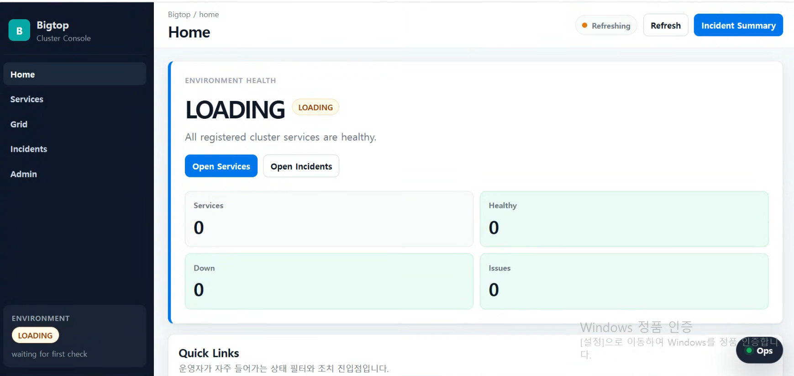
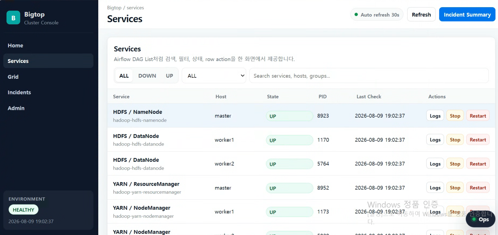
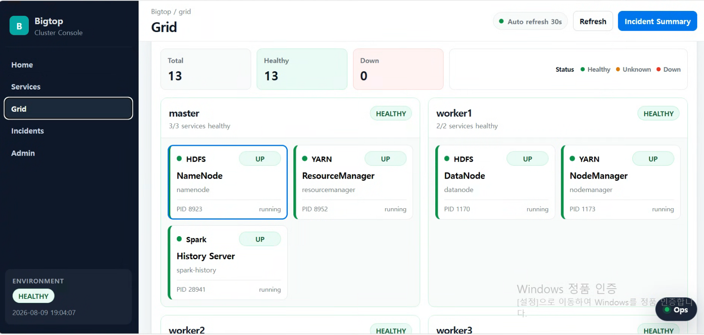

# Bigtop Cluster Ansible

Apache Bigtop과 Ansible을 사용해 Hadoop 기반 미니 데이터 플랫폼을 자동화 방식으로 구성하는 프로젝트입니다.

개인 VM 환경에서 Ambari 같은 통합 관리 도구 없이, Ansible playbook과 role 구조를 통해 서버 공통 설정, Java 설치, Bigtop repository 등록, Hadoop/HDFS/YARN/Spark 설치, 설정 파일 배포, 서비스 기동, 모니터링, 대시보드, 알림, 백업 자동화, 운영 점검, Web Console까지 구성하는 것을 목표로 합니다.

현재는 HDFS, YARN, Spark on YARN, Prometheus/Grafana 기반 모니터링, JMX Exporter 기반 JVM 메트릭 수집, Alertmanager 기반 알림, Grafana datasource/dashboard provisioning, NameNode metadata 보호 및 백업 자동화, HDFS/YARN 상태 기반 alert, NameNode backup 상태 감시, HDFS/YARN/Spark History Server Grafana dashboard, Alertmanager Slack receiver 선택 구성, cluster health check/recovery/smoke test playbook, YARN Capacity Scheduler queue 정책, QueueMetrics 수집/alert/dashboard, YARN/Spark application diagnostics playbook, YARN log aggregation, Spark History Server event log retention, Spark submit resource profile, YARN NodeManager local/log directory 관리 및 disk health checker, NodeManager storage metric/alert/dashboard, 운영 runbook 분리, Makefile 기반 운영 명령 표준화, venv 기반 정적 검증 구성, FastAPI + React 기반 Bigtop Web Console, Web Console action audit log, action history 화면, self-check API, runbook link, audit log rotation, full check 명령, Ops Tools UI까지 구성한 상태입니다.

## 구성

<!-- BEGIN BIGTOP README OCT2026 OVERVIEW -->
> **2026년 10월 운영 확장:** Web Console 조치 이력 PostgreSQL 영속화, 메타데이터/Inventory, 백업·복원 검증(34), 백업 관측(35), Prometheus 백업 장애 알림(36)을 추가했습니다. **37번 Admin 백업 대시보드는 현장 배포 완료 여부를 확인해야 합니다.** 상세 내용은 아래 「Web Console 운영 확장」 절을 참조하세요.
<!-- END BIGTOP README OCT2026 OVERVIEW -->


현재 클러스터는 4대 VM 기준입니다.

```text
master   - HDFS NameNode / YARN ResourceManager / Spark History Server
worker1  - HDFS DataNode / YARN NodeManager
worker2  - HDFS DataNode / YARN NodeManager
worker3  - Ansible Control Node / Ops Node / Prometheus / Grafana / Alertmanager / Bigtop Web Console
```

HA 구성은 적용하지 않았습니다.

개인 VM 리소스 제약으로 NameNode Active-Standby HA, JournalNode, ZKFC 구성은 제외하고, 단일 NameNode 환경에서 metadata 보호와 복구성을 높이는 방향으로 구성했습니다.

```text
NameNode HA = 장애 시 서비스 연속성 확보
NameNode metadata backup = 장애 후 복구 지점 확보
```

본 프로젝트에서는 NameNode HA를 대체하지는 않지만, 단일 NameNode 구조의 위험을 줄이기 위해 다음 개선을 적용했습니다.

```text
1. dfs.namenode.name.dir 복수 디렉터리 구성
2. dfs.namenode.edits.dir 복수 디렉터리 구성
3. fetchImage 기반 NameNode metadata online backup
4. systemd timer 기반 정기 백업
5. worker3 Ops Node로 백업 archive 원격 보관
6. Node Exporter textfile collector 기반 백업 성공/실패 metric 수집
7. Prometheus alert rule 기반 백업 실패/지연 감지
8. HDFS 상태 기반 alert rule 구성
9. Grafana HDFS Health dashboard 자동 provisioning
10. Grafana NameNode Backup dashboard 자동 provisioning
```

## 주요 구성 요소

```text
Ansible        - 서버 설정 및 서비스 자동화
Apache Bigtop  - Hadoop/Spark 패키지 repository
Hadoop HDFS    - 분산 파일 시스템
YARN           - 리소스 관리 및 작업 실행
Spark on YARN  - Spark 작업 실행 환경
systemd        - Hadoop/YARN/Spark/backup/metric timer 서비스 관리
Prometheus     - 메트릭 수집 및 alert rule 평가
Grafana        - 메트릭 시각화 및 dashboard provisioning
Alertmanager   - Prometheus alert 수신 및 알림 관리
Node Exporter  - OS 메트릭 및 textfile collector 메트릭 수집
JMX Exporter   - Hadoop/YARN/Spark JVM 메트릭 수집
rsync/ssh      - NameNode metadata backup 원격 동기화
FastAPI        - Bigtop Web Console backend API
React/Vite     - Bigtop Web Console frontend UI
Nginx          - Web Console reverse proxy 및 Basic Auth
Makefile       - 반복 운영 명령 표준화
yamllint       - YAML 정적 검증
ansible-lint   - Ansible playbook/role 정적 검증
```

## 디렉터리 구조

```text
bigtop-cluster-ansible/
├── ansible.cfg
├── Makefile
├── README.md
├── requirements-dev.txt
├── .yamllint
├── .ansible-lint
├── collections/
│   └── requirements.yml
├── docs/
│   ├── images/
│   │   ├── web_ui_home.png
│   │   ├── web_ui_svc.png
│   │   └── web_ui_grid.png
│   └── runbooks/
│       ├── README.md
│       ├── cluster-reboot-recovery.md
│       ├── monitoring-alert-response.md
│       ├── nodemanager-storage-pressure.md
│       ├── spark-history-and-logs.md
│       └── yarn-spark-application-failure.md
├── inventory/
│   ├── hosts.ini.example
│   └── group_vars/
│       └── all.yml.example
├── playbooks/
│   ├── 01-common.yml
│   ├── 02-java.yml
│   ├── 03-bigtop-repo.yml
│   ├── 04-hadoop-install.yml
│   ├── 05-hdfs-config.yml
│   ├── 06-hdfs-start.yml
│   ├── 06-hdfs-stop.yml
│   ├── 07-yarn-install.yml
│   ├── 08-yarn-config.yml
│   ├── 09-yarn-start.yml
│   ├── 09-yarn-stop.yml
│   ├── 10-spark-install.yml
│   ├── 11-spark-config.yml
│   ├── 12-spark-history-start.yml
│   ├── 12-spark-history-stop.yml
│   ├── 13-node-exporter.yml
│   ├── 14-prometheus.yml
│   ├── 15-grafana.yml
│   ├── 16-jmx-exporter.yml
│   ├── 17-alertmanager.yml
│   ├── 18-namenode-backup.yml
│   ├── 19-namenode-remote-backup.yml
│   ├── 20-cluster-health-check.yml
│   ├── 21-cluster-recover.yml
│   ├── 22-cluster-smoke-test.yml
│   ├── 23-yarn-app-diagnostics.yml
│   ├── 24-yarn-log-aggregation.yml
│   ├── 25-spark-history-maintenance.yml
│   ├── 26-yarn-nodemanager-storage.yml
│   ├── 27-yarn-nodemanager-storage-metrics.yml
│   └── 30-web-console.yml
├── roles/
│   ├── alertmanager/
│   ├── bigtop_repo/
│   ├── common/
│   ├── grafana/
│   │   └── templates/
│   │       ├── dashboards/
│   │       ├── datasources/
│   │       └── dashboard_json/
│   │           ├── bigtop-platform-overview.json.j2
│   │           ├── hdfs-health-overview.json.j2
│   │           ├── namenode-backup-overview.json.j2
│   │           ├── spark-history-overview.json.j2
│   │           ├── yarn-nodemanager-storage-overview.json.j2
│   │           ├── yarn-queue-overview.json.j2
│   │           └── yarn-resource-overview.json.j2
│   ├── hadoop/
│   ├── hdfs_config/
│   ├── java/
│   ├── jmx_exporter/
│   ├── namenode_backup/
│   ├── node_exporter/
│   │   └── templates/
│   │       ├── yarn-nodemanager-storage-metrics.service.j2
│   │       ├── yarn-nodemanager-storage-metrics.sh.j2
│   │       └── yarn-nodemanager-storage-metrics.timer.j2
│   ├── prometheus/
│   ├── spark/
│   ├── spark_config/
│   ├── web_console/
│   │   ├── defaults/
│   │   ├── files/frontend/
│   │   │   └── src/
│   │   │       ├── main.jsx
│   │   │       ├── styles.css
│   │   │       ├── ops-tools.js
│   │   │       └── ops-tools.css
│   │   ├── handlers/
│   │   ├── tasks/
│   │   └── templates/
│   │       ├── app.py.j2
│   │       ├── bigtop-web-console.service.j2
│   │       ├── nginx-bigtop-web-console.conf.j2
│   │       └── bigtop-web-console-actions.logrotate.j2
│   ├── yarn/
│   └── yarn_config/
└── scripts/
    ├── check_static_ops_validation.sh
    ├── check_web_console_full.sh
    └── fix-newline.py
```

## 사전 준비

Ansible Control Node에서 각 서버로 SSH 접속이 가능해야 합니다.

```bash
ansible all -m command -a "whoami"
```

대상 서버에서 passwordless sudo가 가능해야 합니다.

```bash
ansible all -b -m command -a "whoami"
```

정상이라면 `root`가 출력됩니다.

## 설정 파일 준비

실제 inventory와 변수 파일은 Git에 포함하지 않습니다.
예제 파일을 복사해서 각자 환경에 맞게 수정합니다.

```bash
cp inventory/hosts.ini.example inventory/hosts.ini
cp inventory/group_vars/all.yml.example inventory/group_vars/all.yml
```

예제 inventory:

```ini
[master]
master ansible_host=192.168.56.101

[workers]
worker1 ansible_host=192.168.56.102
worker2 ansible_host=192.168.56.103

[ops]
worker3 ansible_host=192.168.56.104

[hadoop_cluster:children]
master
workers

[all:vars]
ansible_user=your_user
ansible_ssh_private_key_file=~/.ssh/id_rsa
ansible_python_interpreter=/usr/bin/python3
```

Hadoop/YARN/Spark/Prometheus 설정에서는 `vm1`, `vm2` 같은 임시 inventory alias 대신 실제 클러스터 hostname인 `master`, `worker1`, `worker2`, `worker3`를 사용합니다.

inventory alias와 실제 hostname을 맞춰두면 다음과 같은 ad-hoc 명령을 직관적으로 사용할 수 있습니다.

```bash
ansible master -m shell -a "hostname"
ansible worker1 -m shell -a "hostname"
ansible worker2 -m shell -a "hostname"
ansible worker3 -m shell -a "hostname"
```

inventory 구조는 다음 명령으로 확인합니다.

```bash
ansible-inventory --graph
```

예상 결과:

```text
@all:
  |--@ungrouped:
  |--@ops:
  |  |--worker3
  |--@hadoop_cluster:
  |  |--@master:
  |  |  |--master
  |  |--@workers:
  |  |  |--worker1
  |  |  |--worker2
```

## 주요 변수 예시

`inventory/group_vars/all.yml.example`에는 다음 항목을 포함합니다.
실제 IP, Slack channel, webhook, SSH key 등 환경 의존 값은 `inventory/group_vars/all.yml`에만 둡니다.

```yaml
# HDFS
hdfs_namenode_host: "master"
hdfs_default_fs: "hdfs://master:9000"
hdfs_replication: 2

hdfs_namenode_name_dirs:
  - "/data/hadoop/hdfs/namenode"
  - "/data2/hadoop/hdfs/namenode"

hdfs_namenode_edits_dirs:
  - "/data/hadoop/hdfs/namenode"
  - "/data2/hadoop/hdfs/namenode"

hdfs_datanode_dir: "/data/hadoop/hdfs/datanode"

# YARN
yarn_resourcemanager_host: "master"
yarn_ui2_enable: true

# YARN NodeManager storage
# loop와 join 필터에서 사용하므로 문자열이 아니라 list 형태로 유지합니다.
yarn_nodemanager_local_dirs:
  - "/data/hadoop/yarn/local"

yarn_nodemanager_log_dirs:
  - "/data/hadoop/yarn/logs"

yarn_nodemanager_resource_memory_mb: 2048
yarn_nodemanager_resource_cpu_vcores: 2
yarn_scheduler_minimum_allocation_mb: 256
yarn_scheduler_maximum_allocation_mb: 2048

# YARN Capacity Scheduler queues
yarn_capacity_scheduler_queues:
  - name: default
    capacity: 40
    maximum_capacity: 100
    user_limit_factor: 1
    maximum_am_resource_percent: 0.2

  - name: batch
    capacity: 40
    maximum_capacity: 100
    user_limit_factor: 2
    maximum_am_resource_percent: 0.3

  - name: adhoc
    capacity: 20
    maximum_capacity: 50
    user_limit_factor: 1
    maximum_am_resource_percent: 0.1

# YARN log aggregation
yarn_log_aggregation_enabled: true
yarn_log_aggregation_remote_app_log_dir: "/tmp/logs"
yarn_log_aggregation_remote_app_log_dir_suffix: "logs"
yarn_log_aggregation_retain_seconds: 604800
yarn_log_aggregation_retain_check_interval_seconds: 3600
yarn_nodemanager_log_retain_seconds: 10800

# YARN NodeManager disk health checker
yarn_nodemanager_disk_health_checker_enabled: true
yarn_nodemanager_disk_max_utilization_percent: 90.0
yarn_nodemanager_disk_min_free_mb: 1024
yarn_nodemanager_disk_min_healthy_disks: 0.25

# YARN NodeManager storage metrics
yarn_nodemanager_storage_metrics_enabled: true
yarn_nodemanager_storage_metrics_interval: "5min"
yarn_nodemanager_storage_used_warning_percent: 80
yarn_nodemanager_storage_used_critical_percent: 90
yarn_nodemanager_storage_available_warning_bytes: 1073741824

# Spark
spark_conf_dir: "/etc/spark/conf"
spark_history_dir: "hdfs:///spark-history"
spark_event_log_dir: "hdfs:///spark-history"
spark_eventlog_dir: "{{ spark_event_log_dir }}"

# Spark History Server event log cleaner
spark_history_cleaner_enabled: true
spark_history_cleaner_interval: "1d"
spark_history_cleaner_max_age: "7d"

# Spark submit default resource profile
spark_default_yarn_queue: "batch"
spark_driver_memory: "512m"
spark_driver_cores: 1
spark_executor_memory: "512m"
spark_executor_cores: 1
spark_executor_instances: 2
spark_yarn_am_memory: "512m"

# Spark submit profile presets
spark_submit_profiles:
  - name: adhoc
    queue: adhoc
    driver_memory: "512m"
    executor_memory: "512m"
    executor_cores: 1
    executor_instances: 1

  - name: batch
    queue: batch
    driver_memory: "512m"
    executor_memory: "768m"
    executor_cores: 1
    executor_instances: 2

# NameNode metadata backup
hdfs_namenode_backup_dir: "/backup/hdfs/namenode"
hdfs_namenode_backup_script: "/usr/local/sbin/backup-namenode-metadata.sh"
hdfs_namenode_backup_retention_days: 7
hdfs_namenode_backup_on_calendar: "*-*-* 03:30:00"

# NameNode remote backup
hdfs_namenode_remote_backup_enabled: true
hdfs_namenode_remote_backup_host: "worker3"
hdfs_namenode_remote_backup_user: "hdfsbackup"
hdfs_namenode_remote_backup_dir: "/backup/remote/hdfs/namenode/master"
hdfs_namenode_remote_backup_ssh_key: "/root/.ssh/namenode_backup_ed25519"

# Node Exporter textfile collector
node_exporter_textfile_dir: "/var/lib/prometheus/node-exporter"

# NameNode backup metrics
hdfs_namenode_backup_metric_file: "{{ node_exporter_textfile_dir }}/namenode_backup.prom"
hdfs_namenode_backup_max_age_seconds: 93600

# HDFS alert thresholds
hdfs_expected_live_datanodes: 2
hdfs_capacity_warning_percent: 80
hdfs_capacity_critical_percent: 90

# YARN alert thresholds
yarn_expected_active_nodemanagers: 2
yarn_memory_warning_percent: 80
yarn_memory_critical_percent: 90
yarn_vcore_warning_percent: 80
yarn_vcore_critical_percent: 90

# Alertmanager Slack receiver
# example에서는 false로 유지하고, 실제 all.yml에서만 true로 변경합니다.
alertmanager_slack_enabled: false
alertmanager_slack_channel: "#bigtop-alerts"
alertmanager_slack_webhook_file: "/etc/prometheus/alertmanager-secrets/slack_webhook_url"

# Bigtop Web Console
web_console_enabled: true
web_console_host: "127.0.0.1"
web_console_port: 18090
web_console_public_port: 1337
web_console_user: "bigtop-web-console"
web_console_group: "bigtop-web-console"
web_console_app_dir: "/opt/bigtop-web-console"
web_console_venv_dir: "/opt/bigtop-web-console/.venv"
web_console_project_root: "{{ playbook_dir }}/.."

# Bigtop Web Console audit log
web_console_audit_log_dir: "/var/log/bigtop-web-console"
web_console_audit_log_file: "{{ web_console_audit_log_dir }}/actions.log"
web_console_audit_log_max_items: 200
web_console_audit_log_owner: "bigtop-web-console"
web_console_audit_log_group: "bigtop-web-console"

# Bigtop Web Console audit log rotation
web_console_audit_log_rotate_count: 14
web_console_audit_log_rotate_size: "10M"
web_console_audit_log_rotate_config: "/etc/logrotate.d/bigtop-web-console-actions"
```

## 실행 순서

전체 구성은 다음 순서로 실행합니다.

```bash
ansible-playbook playbooks/01-common.yml
ansible-playbook playbooks/02-java.yml
ansible-playbook playbooks/03-bigtop-repo.yml
ansible-playbook playbooks/04-hadoop-install.yml
ansible-playbook playbooks/05-hdfs-config.yml
ansible-playbook playbooks/06-hdfs-start.yml
ansible-playbook playbooks/07-yarn-install.yml
ansible-playbook playbooks/08-yarn-config.yml
ansible-playbook playbooks/09-yarn-start.yml
ansible-playbook playbooks/10-spark-install.yml
ansible-playbook playbooks/11-spark-config.yml
ansible-playbook playbooks/12-spark-history-start.yml
ansible-playbook playbooks/13-node-exporter.yml
ansible-playbook playbooks/14-prometheus.yml
ansible-playbook playbooks/15-grafana.yml
ansible-playbook playbooks/16-jmx-exporter.yml
ansible-playbook playbooks/17-alertmanager.yml
ansible-playbook playbooks/18-namenode-backup.yml
ansible-playbook playbooks/19-namenode-remote-backup.yml
ansible-playbook playbooks/20-cluster-health-check.yml
ansible-playbook playbooks/21-cluster-recover.yml
ansible-playbook playbooks/22-cluster-smoke-test.yml
ansible-playbook playbooks/24-yarn-log-aggregation.yml
ansible-playbook playbooks/25-spark-history-maintenance.yml
ansible-playbook playbooks/26-yarn-nodemanager-storage.yml
ansible-playbook playbooks/27-yarn-nodemanager-storage-metrics.yml
ansible-playbook playbooks/30-web-console.yml
```

서비스 중지는 다음 playbook으로 수행합니다.

```bash
ansible-playbook playbooks/12-spark-history-stop.yml
ansible-playbook playbooks/09-yarn-stop.yml
ansible-playbook playbooks/06-hdfs-stop.yml
```

## Makefile Operation Commands

반복적으로 사용하는 Ansible 운영 명령은 Makefile target으로 제공합니다.

```bash
make help
```

기본 점검:

```bash
make inventory
make ping
make syntax
make health
```

VM 재기동 후 복구 및 검증:

```bash
make post-reboot
```

`make post-reboot`는 다음 순서로 실행합니다.

```text
1. ansible all -m ping
2. playbooks/21-cluster-recover.yml
3. playbooks/20-cluster-health-check.yml
4. playbooks/22-cluster-smoke-test.yml
```

YARN/Spark application 진단:

```bash
make diagnostics APP_ID=application_XXXXXXXXXXXX_XXXX
```

YARN/Spark 운영 작업:

```bash
make yarn-log-aggregation
make spark-history-maintenance
make nm-storage
make nm-storage-metrics
```

Bigtop Web Console 운영 작업:

```bash
make web-console
make web-console-check
make web-console-logs

# Action audit/history
make web-console-actions
make web-console-actions-json
make web-console-actions-page

# Self check / runbook / UI check
make web-console-self-check
make web-console-runbooks
make web-console-runbooks-page
make web-console-ui-check
make web-console-ui-clean-check

# Audit log rotation / permission
make web-console-logrotate-check
make web-console-audit-permission-check

# 통합 점검
make web-console-full-check
make wcf
```

Monitoring stack 재적용:

```bash
make monitoring
```

전체 구성 보조 명령:

```bash
make apply-core
make apply-observability
make apply-ops
```

## Static Validation

로컬 개발 검증 도구는 Python virtual environment에 설치합니다.

```bash
make venv
make collections
```

정적 검증:

```bash
make lint
make validate
```

`make lint`는 다음 항목을 실행합니다.

```text
1. yamllint
2. ansible-lint
```

`make validate`는 다음 항목을 검사합니다.

```text
1. 필수 명령어 설치 여부
2. Git에 민감 파일 또는 runtime artifact가 추적 중인지 여부
3. group_vars example 중복 key 여부
4. Ansible inventory graph 생성 가능 여부
5. yamllint 검사
6. ansible-lint 검사
7. 전체 playbook syntax-check
```

검증 도구는 다음 파일로 관리합니다.

```text
requirements-dev.txt
collections/requirements.yml
.yamllint
.ansible-lint
scripts/check_static_ops_validation.sh
scripts/fix-newline.py
```

커밋 전 기본 루틴:

```bash
make lint
make validate
git status --short
```

## HDFS 설정 기준

```text
NameNode: master
DataNode: worker1, worker2
fs.defaultFS: hdfs://master:9000
dfs.replication: 2
NameNode name dirs:
  - /data/hadoop/hdfs/namenode
  - /data2/hadoop/hdfs/namenode
NameNode edits dirs:
  - /data/hadoop/hdfs/namenode
  - /data2/hadoop/hdfs/namenode
DataNode dir: /data/hadoop/hdfs/datanode
```

HDFS 상태 확인:

```bash
ansible master -b -m command -a "systemctl is-active hadoop-hdfs-namenode"
ansible workers -b -m command -a "systemctl is-active hadoop-hdfs-datanode"
ansible master -b -m shell -a "sudo -u hdfs hdfs dfsadmin -report"
```

정상 상태에서는 `Live datanodes (2)`가 출력됩니다.

NameNode RPC/Web UI 포트 확인:

```bash
ansible master -m shell -a "ss -lntp | grep -E '9000|9870' || true"
```

NameNode metadata directory 확인:

```bash
ansible master -b -m shell -a "ls -lh /data/hadoop/hdfs/namenode/current/fsimage_* | tail"
ansible master -b -m shell -a "ls -lh /data2/hadoop/hdfs/namenode/current/fsimage_* | tail"
```

복수 metadata directory가 정상 적용되면 NameNode 로그에서 다음 warning이 더 이상 발생하지 않습니다.

```text
Only one image storage directory configured.
Only one namespace edits storage directory configured.
```

## YARN 설정 기준

```text
ResourceManager: master
NodeManager: worker1, worker2
ResourceManager Web UI: http://master:8088
YARN UI2: http://master:8088/ui2
```

YARN 상태 확인:

```bash
ansible master -b -m command -a "systemctl is-active hadoop-yarn-resourcemanager"
ansible workers -b -m command -a "systemctl is-active hadoop-yarn-nodemanager"
ansible master -b -m shell -a "sudo -u yarn yarn node -list"
```

정상 상태에서는 `Total Nodes:2`가 출력됩니다.

## YARN Capacity Scheduler

Spark 작업 간 리소스 경합을 제어하기 위해 YARN Capacity Scheduler queue를 구성합니다.

현재 queue 구조는 다음 기준입니다.

```text
root
├── default  40%
├── batch    40%
└── adhoc    20%
```

queue 용도는 다음과 같이 구분합니다.

```text
default - 기본 작업
batch   - 정기/대용량 배치 작업
adhoc   - 테스트/임시 분석 작업
```

Capacity Scheduler queue는 Ansible 변수로 관리합니다.

```yaml
yarn_capacity_scheduler_queues:
  - name: default
    capacity: 40
    maximum_capacity: 100
  - name: batch
    capacity: 40
    maximum_capacity: 100
  - name: adhoc
    capacity: 20
    maximum_capacity: 50
```

설정 파일은 `roles/yarn_config/templates/capacity-scheduler.xml.j2`에서 관리하고, `playbooks/08-yarn-config.yml`로 배포합니다.

적용:

```bash
ansible-playbook playbooks/08-yarn-config.yml
ansible master -b -m shell -a "sudo -u yarn yarn rmadmin -refreshQueues"
```

queue 확인:

```bash
ansible master -m shell -a "curl -s http://master:8088/ws/v1/cluster/scheduler | python3 -m json.tool | grep -E 'queueName|capacity|maximumCapacity' | head -80"
```

Spark job은 `--queue` 옵션으로 특정 queue에 제출할 수 있습니다.

```bash
spark-submit --master yarn --queue batch ...
spark-submit --master yarn --queue adhoc ...
```


## YARN Log Aggregation

YARN/Spark application 로그를 완료 후에도 조회할 수 있도록 YARN log aggregation을 활성화합니다.
로그는 NodeManager 로컬 디렉터리에만 남기지 않고 HDFS의 remote app log directory로 모읍니다.

```text
Remote app log dir: /tmp/logs
Remote app log suffix: logs
Aggregated log retention: 7 days
NodeManager local log retention: 3 hours
```

관련 설정은 `yarn-site.xml`에 반영합니다.

```xml
<property>
  <name>yarn.log-aggregation-enable</name>
  <value>true</value>
</property>

<property>
  <name>yarn.nodemanager.remote-app-log-dir</name>
  <value>/tmp/logs</value>
</property>

<property>
  <name>yarn.nodemanager.remote-app-log-dir-suffix</name>
  <value>logs</value>
</property>

<property>
  <name>yarn.log-aggregation.retain-seconds</name>
  <value>604800</value>
</property>
```

HDFS log aggregation directory는 별도 playbook으로 준비합니다.

```bash
ansible-playbook playbooks/24-yarn-log-aggregation.yml
```

Spark/YARN application 완료 후 다음 명령으로 aggregated log를 확인할 수 있습니다.

```bash
ansible master -b -m shell -a "sudo -u hadoop yarn logs -applicationId application_XXXXXXXXXXXX_XXXX | head -100"
```

YARN UI2에서 로그 버튼을 바로 사용하려면 Application Timeline Service 또는 JobHistory Server 상태의 영향을 받을 수 있습니다.
다만 Spark on YARN 운영 기준에서는 UI2 편의 기능보다 `YARN Log Aggregation + Spark History Server + yarn logs -applicationId + diagnostics playbook` 조합을 우선합니다.

## YARN NodeManager Storage

Spark on YARN 작업 실행 시 NodeManager는 local directory에 Spark library, configuration, container launch script 등을 localization하고, log directory에 container log를 기록합니다.
따라서 NodeManager local/log directory를 명시적으로 관리합니다.

```text
Local dirs: /data/hadoop/yarn/local
Log dirs  : /data/hadoop/yarn/logs
```

관련 설정은 `yarn-site.xml`에 반영합니다.

```xml
<property>
  <name>yarn.nodemanager.local-dirs</name>
  <value>/data/hadoop/yarn/local</value>
</property>

<property>
  <name>yarn.nodemanager.log-dirs</name>
  <value>/data/hadoop/yarn/logs</value>
</property>
```

NodeManager disk health checker도 함께 활성화합니다.

```xml
<property>
  <name>yarn.nodemanager.disk-health-checker.enable</name>
  <value>true</value>
</property>

<property>
  <name>yarn.nodemanager.disk-health-checker.max-disk-utilization-per-disk-percentage</name>
  <value>90.0</value>
</property>

<property>
  <name>yarn.nodemanager.disk-health-checker.min-free-space-per-disk-mb</name>
  <value>1024</value>
</property>
```

디렉터리 생성 및 확인:

```bash
ansible-playbook playbooks/26-yarn-nodemanager-storage.yml
ansible workers -b -m shell -a "ls -ld /data/hadoop/yarn/local /data/hadoop/yarn/logs"
ansible workers -b -m shell -a "df -h /data/hadoop/yarn/local /data/hadoop/yarn/logs"
```

## YARN NodeManager Storage Metrics

NodeManager local/log directory의 디스크 사용량을 Node Exporter textfile collector를 통해 Prometheus metric으로 노출합니다.

수집 대상:

```text
/data/hadoop/yarn/local
/data/hadoop/yarn/logs
```

metric exporter는 systemd service/timer로 관리합니다.

```text
Script : /usr/local/sbin/export-yarn-nodemanager-storage-metrics.sh
Service: yarn-nodemanager-storage-metrics.service
Timer  : yarn-nodemanager-storage-metrics.timer
Metric : /var/lib/prometheus/node-exporter/yarn_nodemanager_storage.prom
```

대표 metric:

```promql
yarn_nodemanager_storage_path_exists
yarn_nodemanager_storage_total_bytes
yarn_nodemanager_storage_used_bytes
yarn_nodemanager_storage_available_bytes
yarn_nodemanager_storage_used_percent
yarn_nodemanager_storage_last_success_timestamp_seconds
```

적용:

```bash
ansible-playbook playbooks/27-yarn-nodemanager-storage-metrics.yml
ansible-playbook playbooks/30-web-console.yml
```

확인:

```bash
ansible workers -b -m command -a "systemctl is-active yarn-nodemanager-storage-metrics.timer"
ansible workers -b -m shell -a "cat /var/lib/prometheus/node-exporter/yarn_nodemanager_storage.prom"
ansible workers -m shell -a "curl -s http://127.0.0.1:9100/metrics | grep yarn_nodemanager_storage"
```

Prometheus alert rule은 다음 상황을 감지합니다.

```text
YARNNodeManagerStorageMetricsMissing
YARNNodeManagerStoragePathMissing
YARNNodeManagerStorageUsageHigh
YARNNodeManagerStorageUsageCritical
YARNNodeManagerStorageAvailableLow
```

## Spark 설정 기준

```text
Spark 실행 모드: Spark on YARN
Spark History Server: master
Spark History Server UI: http://master:18080
Event log dir: hdfs:///spark-history
```

Spark 상태 확인:

```bash
ansible hadoop_cluster -m shell -a "spark-submit --version | head -20"
ansible master -b -m command -a "systemctl is-active spark-history-server"
ansible master -m shell -a "ss -lntp | grep -E '18080|19105' || true"
```

Spark History Server는 VM 재부팅 이후에도 자동으로 기동되도록 `enabled: true`로 관리합니다.
또한 Bigtop 패키지의 `spark-history-server`가 native systemd unit이 아니라 `/etc/init.d` 기반 SysV generated service로 동작하기 때문에, systemd override를 추가해 부팅 시 네트워크와 NameNode 이후에 기동되고 실패 시 재시도되도록 구성합니다.

```text
Override path: /etc/systemd/system/spark-history-server.service.d/override.conf
After: network-online.target hadoop-hdfs-namenode.service
Wants: network-online.target hadoop-hdfs-namenode.service
Restart: on-failure
RestartSec: 30
```

Spark History Server systemd override 확인:

```bash
ansible master -b -m shell -a "systemctl cat spark-history-server"
ansible master -b -m command -a "systemctl is-enabled spark-history-server"
ansible master -b -m command -a "systemctl is-active spark-history-server"
```

Spark History Server JMX Exporter 확인:

```bash
ansible master -m shell -a "curl -s http://127.0.0.1:19105/metrics | grep -E 'jvm_threads_current|jvm_memory_used_bytes' | head"
```

SparkPi 테스트:

```bash
ansible master -b -m shell -a "sudo -u hadoop spark-submit --master yarn --deploy-mode client --class org.apache.spark.examples.SparkPi \$(find /usr -name 'spark-examples*.jar' 2>/dev/null | head -1) 10"
```

정상 실행 시 YARN UI와 Spark History Server에서 Spark application을 확인할 수 있습니다.

## Spark History Server Event Log Retention

Spark History Server는 `hdfs:///spark-history` 경로의 Spark event log를 읽어 완료된 Spark application 정보를 제공합니다.
Spark application이 지속적으로 실행되면 event log가 HDFS에 계속 누적될 수 있으므로, History Server cleaner를 활성화하여 오래된 event log를 자동 정리합니다.

```properties
spark.eventLog.enabled true
spark.eventLog.dir hdfs:///spark-history
spark.history.fs.cleaner.enabled true
spark.history.fs.cleaner.interval 1d
spark.history.fs.cleaner.maxAge 7d
```

Spark event log 저장소 점검용 playbook을 제공합니다.

```bash
ansible-playbook playbooks/25-spark-history-maintenance.yml
```

점검 항목:

```text
- Spark History Server service 상태
- spark.eventLog 설정
- spark.history.fs.cleaner 설정
- hdfs:///spark-history 디렉터리 존재 여부
- Spark event log 용량
- 최근 Spark event log 목록
- Spark History Server API 응답
```

## Spark Submit Resource Profile

Spark 작업이 YARN queue와 cluster resource를 과도하게 점유하지 않도록 기본 Spark submit resource profile을 구성합니다.
기본 설정은 `spark-defaults.conf`에 반영합니다.

```properties
spark.yarn.queue batch
spark.driver.memory 512m
spark.driver.cores 1
spark.executor.memory 512m
spark.executor.cores 1
spark.executor.instances 2
spark.yarn.am.memory 512m
```

또한 profile 기반 Spark submit wrapper를 제공합니다.

```bash
spark-submit-profile <profile> [spark-submit args...]
```

현재 profile:

```text
adhoc - adhoc queue, small resource
batch - batch queue, default batch resource
```

예시:

```bash
spark-submit-profile adhoc \
  --class org.apache.spark.examples.SparkPi \
  /path/to/spark-examples.jar \
  10

spark-submit-profile batch \
  --class org.apache.spark.examples.SparkPi \
  /path/to/spark-examples.jar \
  10
```

이 wrapper를 사용하면 Spark job 제출 시 queue와 resource 옵션을 표준화할 수 있습니다.

## Monitoring 설정 기준

```text
Prometheus: worker3:9090
Grafana: worker3:3000
Alertmanager: worker3:9093
Node Exporter: all nodes:9100
```

Prometheus, Grafana, Alertmanager는 `worker3`에서 실행합니다.
Node Exporter는 전체 노드에 설치하여 CPU, Memory, Disk, Network 등 OS 메트릭을 수집합니다.

Node Exporter는 textfile collector를 활성화하여 NameNode metadata backup 결과도 metric으로 수집합니다.

```text
Textfile collector dir: /var/lib/prometheus/node-exporter
NameNode backup metric file: /var/lib/prometheus/node-exporter/namenode_backup.prom
```

상태 확인:

```bash
ansible all -b -m command -a "systemctl is-active prometheus-node-exporter"
ansible ops -b -m command -a "systemctl is-active prometheus"
ansible ops -b -m command -a "systemctl is-active grafana-server"
ansible ops -b -m command -a "systemctl is-active prometheus-alertmanager"
```

Prometheus health check:

```bash
ansible ops -m shell -a "curl -s http://127.0.0.1:9090/-/healthy"
```

Alertmanager health check:

```bash
ansible ops -m shell -a "curl -s http://127.0.0.1:9093/-/healthy"
```

접속 URL:

```text
Prometheus Targets: http://worker3:9090/targets
Prometheus Alerts : http://worker3:9090/alerts
Grafana           : http://worker3:3000
Alertmanager      : http://worker3:9093
```

## Grafana Provisioning 설정 기준

Grafana datasource와 dashboard는 UI에서 수동 등록하지 않고 Ansible로 자동 배포합니다.

```text
Datasource: Prometheus
Datasource URL: http://localhost:9090
Dashboard folder: Bigtop Cluster
Dashboard file dir: /var/lib/grafana/dashboards
Datasource provisioning dir: /etc/grafana/provisioning/datasources
Dashboard provisioning dir: /etc/grafana/provisioning/dashboards
```

Grafana provisioning 확인:

```bash
ansible ops -b -m shell -a "ls -al /etc/grafana/provisioning/datasources"
ansible ops -b -m shell -a "ls -al /etc/grafana/provisioning/dashboards"
ansible ops -b -m shell -a "ls -al /var/lib/grafana/dashboards"
```

Grafana 로그 확인:

```bash
ansible ops -b -m shell -a "journalctl -u grafana-server -n 100 --no-pager | grep -iE 'provision|dashboard|datasource|error' || true"
```

현재 자동 배포되는 dashboard는 다음과 같습니다.

```text
Dashboards
→ Bigtop Cluster
→ Bigtop Platform Overview

Dashboards
→ Bigtop Cluster
→ HDFS Health Overview

Dashboards
→ Bigtop Cluster
→ NameNode Backup Overview

Dashboards
→ Bigtop Cluster
→ YARN ResourceManager Overview

Dashboards
→ Bigtop Cluster
→ Spark History Server Overview

Dashboards
→ Bigtop Cluster
→ YARN Queue Overview

Dashboards
→ Bigtop Cluster
→ YARN NodeManager Storage Overview
```

### Bigtop Platform Overview

기본 dashboard에는 다음 항목을 포함합니다.

```text
Node Exporter UP
Targets Down
JMX Targets UP
Active Alerts
CPU Usage by Node
Memory Usage by Node
Disk Usage by Node
Target Availability
```

### HDFS Health Overview

HDFS Health dashboard에는 다음 항목을 포함합니다.

```text
Live DataNodes
Dead DataNodes
Missing Blocks
Low Redundancy Blocks
Corrupt Blocks
Pending Reconstruction Blocks
HDFS Capacity Usage %
HDFS Used Capacity
HDFS Remaining Capacity
HDFS Total Capacity
HDFS Block Health
```

HDFS dashboard 배포 확인:

```bash
ansible ops -b -m shell -a "ls -lh /var/lib/grafana/dashboards"
```

기대 파일:

```text
bigtop-platform-overview.json
hdfs-health-overview.json
namenode-backup-overview.json
yarn-resource-overview.json
spark-history-overview.json
yarn-queue-overview.json
yarn-nodemanager-storage-overview.json
```

### NameNode Backup Overview

NameNode Backup dashboard에는 다음 항목을 포함합니다.

```text
Backup Success
Backup Exit Code
Backup Duration
Last Run Timestamp
Last Success Timestamp
Backup Stale Age
Backup Stale Threshold
```

NameNode backup metric은 Node Exporter textfile collector를 통해 수집합니다.
Metric 파일은 Node Exporter가 읽을 수 있도록 `0644` 권한으로 생성합니다.

```text
Metric file: /var/lib/prometheus/node-exporter/namenode_backup.prom
Required mode: 0644
```

확인:

```bash
ansible master -b -m shell -a "ls -lh /var/lib/prometheus/node-exporter/namenode_backup.prom"
ansible master -m shell -a "curl -s http://127.0.0.1:9100/metrics | grep hdfs_namenode_backup || true"
```

### YARN ResourceManager Overview

YARN ResourceManager dashboard에는 다음 항목을 포함합니다.

```text
Active NodeManagers
Lost NodeManagers
Unhealthy NodeManagers
Shutdown NodeManagers
YARN Memory Usage
YARN vCore Usage
YARN Memory Used / Remaining / Total
YARN vCore Used / Remaining / Total
ResourceManager Event Processor CPU
Scheduler Node Update
```

YARN metric은 실제 수집된 ResourceManager ClusterMetrics 기준으로 구성합니다.

```promql
hadoop_resourcemanager_clustermetrics_numactivenms{job="yarn-resourcemanager-jmx"}
hadoop_resourcemanager_clustermetrics_numlostnms{job="yarn-resourcemanager-jmx"}
hadoop_resourcemanager_clustermetrics_numunhealthynms{job="yarn-resourcemanager-jmx"}
hadoop_resourcemanager_clustermetrics_numshutdownnms{job="yarn-resourcemanager-jmx"}
hadoop_resourcemanager_clustermetrics_utilizedmb{job="yarn-resourcemanager-jmx"}
hadoop_resourcemanager_clustermetrics_capabilitymb{job="yarn-resourcemanager-jmx"}
hadoop_resourcemanager_clustermetrics_utilizedvirtualcores{job="yarn-resourcemanager-jmx"}
hadoop_resourcemanager_clustermetrics_capabilityvirtualcores{job="yarn-resourcemanager-jmx"}
```

### Spark History Server Overview

Spark History Server dashboard에는 다음 항목을 포함합니다.

```text
Spark History JMX UP
JVM Threads
Heap Used
Heap Usage %
JVM Heap Memory
JVM Non-Heap Memory
JVM GC Count
```

Spark History Server JMX Exporter의 JVM metric은 다음 이름을 기준으로 사용합니다.

```promql
jvm_memory_used_bytes{job="spark-history-jmx", area="heap"}
jvm_memory_committed_bytes{job="spark-history-jmx", area="heap"}
jvm_memory_max_bytes{job="spark-history-jmx", area="heap"}
jvm_threads_current{job="spark-history-jmx"}
jvm_gc_collection_seconds_count{job="spark-history-jmx"}
```

### YARN Queue Overview

YARN Queue Overview dashboard는 Capacity Scheduler queue별 작업 상태와 리소스 사용량을 시각화합니다.

수집 대상 queue:

```text
root
├── default
├── batch
└── adhoc
```

dashboard 주요 패널:

```text
Queue Metrics UP
Running Apps
Pending Apps
Failed Apps Increase
Queue Running / Pending Apps
Queue Memory MB
Queue vCores
Queue Containers
Queue Memory Usage %
Queue Failed / Killed Apps
```

대표 Prometheus metric:

```promql
yarn_queue_appsrunning{queue="batch"}
yarn_queue_appspending{queue="batch"}
yarn_queue_allocatedmb{queue="batch"}
yarn_queue_availablemb{queue="batch"}
yarn_queue_pendingmb{queue="batch"}
yarn_queue_appsfailed{queue="batch"}
```

확인:

```bash
ansible ops -b -m shell -a "ls -lh /var/lib/grafana/dashboards | grep yarn"
ansible ops -m shell -a "curl -s 'http://127.0.0.1:9090/api/v1/query?query=yarn_queue_appsrunning'"
```

### YARN NodeManager Storage Overview

YARN NodeManager Storage Overview dashboard는 NodeManager local/log directory의 디스크 사용량을 노드별, 경로별로 시각화합니다.

dashboard 주요 패널:

```text
Storage Paths Exists
Max Storage Usage %
Min Available Space
Last Metric Collection
NodeManager Storage Used %
NodeManager Storage Available Bytes
NodeManager Storage Table
```

대표 Prometheus metric:

```promql
yarn_nodemanager_storage_path_exists{job="node-exporter"}
yarn_nodemanager_storage_used_percent{job="node-exporter"}
yarn_nodemanager_storage_available_bytes{job="node-exporter"}
yarn_nodemanager_storage_last_success_timestamp_seconds{job="node-exporter"}
```

확인:

```bash
ansible ops -b -m shell -a "ls -lh /var/lib/grafana/dashboards | grep yarn-nodemanager-storage"
ansible ops -m shell -a "curl -s 'http://127.0.0.1:9090/api/v1/query?query=yarn_nodemanager_storage_used_percent'"
```

Grafana dashboard provisioning task는 다음 흐름으로 구성합니다.

```text
1. datasource provisioning
2. dashboard provider provisioning
3. bigtop-platform-overview.json 배포
4. hdfs-health-overview.json 배포
5. namenode-backup-overview.json 배포
6. yarn-resource-overview.json 배포
7. spark-history-overview.json 배포
8. yarn-queue-overview.json 배포
9. yarn-nodemanager-storage-overview.json 배포
10. grafana-server 재시작
```

## JMX Exporter 설정 기준

JMX Exporter를 사용해 Hadoop/YARN/Spark JVM 메트릭을 Prometheus에서 수집합니다.

```text
NameNode JMX Exporter: master:19101
DataNode JMX Exporter: worker1/worker2:19102
ResourceManager JMX Exporter: master:19103
NodeManager JMX Exporter: worker1/worker2:19104
Spark History Server JMX Exporter: master:19105
```

JMX Exporter 확인:

```bash
ansible master -m shell -a "curl -s http://localhost:19101/metrics | head"
ansible master -m shell -a "curl -s http://localhost:19103/metrics | head"
ansible master -m shell -a "curl -s http://localhost:19105/metrics | head"
ansible workers -m shell -a "curl -s http://localhost:19102/metrics | head"
ansible workers -m shell -a "curl -s http://localhost:19104/metrics | head"
```

정상 상태에서는 Prometheus metric 형식의 `# HELP`, `# TYPE` 출력이 확인됩니다.

Prometheus에서 JMX target 상태 확인:

```bash
ansible ops -m shell -a "curl -s 'http://127.0.0.1:9090/api/v1/query?query=up%7Bjob%3D~%22.*jmx%22%7D'"
```

NameNode FSNamesystem metric 확인:

```bash
ansible master -m shell -a "curl -s http://127.0.0.1:19101/metrics | grep -Ei 'numlive|numdead|missing|lowredundancy|capacity' | head -100"
```

JMX Exporter의 Hadoop rule은 metric name에 attribute value가 붙지 않도록 정리했습니다.

이전 문제 형태:

```text
hadoop_namenode_fsnamesystem_numlivedatanodes__2 2.0
hadoop_namenode_fsnamesystem_numdeaddatanodes__0 0.0
hadoop_namenode_fsnamesystem_capacityused__335872 335872.0
```

정리 후 형태:

```text
hadoop_namenode_fsnamesystem_numlivedatanodes 2.0
hadoop_namenode_fsnamesystem_numdeaddatanodes 0.0
hadoop_namenode_fsnamesystem_capacityused 335872.0
hadoop_namenode_fsnamesystem_capacitytotal 1.00807254016E11
```

핵심 rule:

```yaml
---
lowercaseOutputName: true
lowercaseOutputLabelNames: true

rules:
  - pattern: 'Hadoop<service=([^,>]+), name=([^,>]+)><>([^:]+):.*'
    name: hadoop_$1_$2_$3
    type: GAUGE
```

이 rule은 `:` 앞의 attribute 이름만 metric name으로 사용하고, 실제 값은 metric value로 유지합니다.

Prometheus query 예시:

```bash
ansible ops -m shell -a "curl -s 'http://127.0.0.1:9090/api/v1/query?query=hadoop_namenode_fsnamesystem_numlivedatanodes'"
ansible ops -m shell -a "curl -s 'http://127.0.0.1:9090/api/v1/query?query=hadoop_namenode_fsnamesystem_numdeaddatanodes'"
```

정상 상태:

```text
hadoop_namenode_fsnamesystem_numlivedatanodes = 2
hadoop_namenode_fsnamesystem_numdeaddatanodes = 0
```

### YARN QueueMetrics 수집

Capacity Scheduler queue 운영 상태를 확인하기 위해 ResourceManager QueueMetrics를 JMX Exporter로 수집합니다.

YARN JMX 원본 확인:

```bash
ansible master -m shell -a "curl -s 'http://master:8088/jmx?qry=Hadoop:service=ResourceManager,name=QueueMetrics,*' | grep -E 'QueueMetrics|AppsRunning|AppsPending|AllocatedMB|AvailableMB' | head -80"
```

JMX Exporter rule은 `QueueMetrics` MBean의 `q1` 값을 queue label로 변환합니다.

```text
root.default → queue="default"
root.batch   → queue="batch"
root.adhoc   → queue="adhoc"
```

수집 결과는 다음과 같은 metric으로 노출됩니다.

```text
yarn_queue_appsrunning{queue="batch"}
yarn_queue_appspending{queue="adhoc"}
yarn_queue_allocatedmb{queue="batch"}
yarn_queue_availablemb{queue="default"}
yarn_queue_pendingmb{queue="adhoc"}
```

확인:

```bash
ansible master -m shell -a "curl -s http://127.0.0.1:19103/metrics | grep yarn_queue | head -80"
ansible ops -m shell -a "curl -s 'http://127.0.0.1:9090/api/v1/query?query=yarn_queue_appsrunning' | python3 -m json.tool | head -80"
```

## NameNode metadata backup

NameNode FSImage 손상 복구 경험을 바탕으로 metadata 보호 체계를 구성했습니다.

백업 구성은 다음과 같습니다.

```text
Backup method: hdfs dfsadmin -fetchImage
Local backup dir: /backup/hdfs/namenode
Backup script: /usr/local/sbin/backup-namenode-metadata.sh
Timer: namenode-metadata-backup.timer
Retention: 7 days
Remote backup target: worker3:/backup/remote/hdfs/namenode/master
```

백업은 실행 중인 NameNode에서 `fetchImage`를 통해 최신 fsimage를 가져오고, VERSION 파일과 주요 Hadoop 설정 파일을 함께 archive로 묶습니다.

백업 archive에는 다음 항목이 포함됩니다.

```text
fsimage_*
VERSION
MANIFEST.txt
conf/core-site.xml
conf/hdfs-site.xml
conf/hadoop-env.sh
```

백업 timer 확인:

```bash
ansible master -b -m command -a "systemctl status namenode-metadata-backup.timer --no-pager -l"
ansible master -b -m shell -a "systemctl list-timers --all | grep namenode || true"
```

수동 백업 실행:

```bash
ansible master -b -m shell -a "/usr/local/sbin/backup-namenode-metadata.sh"
```

systemd service로 실행:

```bash
ansible master -b -m command -a "systemctl start namenode-metadata-backup.service"
```

백업 로그 확인:

```bash
ansible master -b -m shell -a "journalctl -u namenode-metadata-backup.service -n 100 --no-pager"
```

local backup 확인:

```bash
ansible master -b -m shell -a "ls -lh /backup/hdfs/namenode"
```

remote backup 확인:

```bash
ansible ops -b -m shell -a "ls -lh /backup/remote/hdfs/namenode/master"
```

checksum 검증:

```bash
ansible ops -b -m shell -a "cd /backup/remote/hdfs/namenode/master && sha256sum -c *.sha256"
```

압축 내용 확인:

```bash
ansible ops -b -m shell -a "tar tzf \$(ls -1t /backup/remote/hdfs/namenode/master/namenode-metadata-*.tgz | head -1) | head -30"
```

백업 결과 metric 확인:

```bash
ansible master -b -m shell -a "cat /var/lib/prometheus/node-exporter/namenode_backup.prom"
ansible master -m shell -a "curl -s http://127.0.0.1:9100/metrics | grep hdfs_namenode_backup || true"
```

Prometheus query:

```bash
ansible ops -m shell -a "curl -s 'http://127.0.0.1:9090/api/v1/query?query=hdfs_namenode_backup_success'"
```

## Alertmanager 설정 기준

Alertmanager는 Prometheus에서 발생한 alert를 수신하고 관리하는 역할을 합니다.
기본적으로는 Alertmanager UI에서 alert를 확인할 수 있으며, 선택적으로 Slack Incoming Webhook receiver를 활성화해 alert를 Slack channel로 전달할 수 있습니다.

```text
Alertmanager host: worker3
Alertmanager port: 9093
Alertmanager config: /etc/prometheus/alertmanager.yml
Prometheus rule dir: /etc/prometheus/rules
```

Prometheus rule 검증:

```bash
ansible ops -b -m shell -a "promtool check config /etc/prometheus/prometheus.yml"
ansible ops -b -m shell -a "promtool check rules /etc/prometheus/rules/platform-alerts.yml"
```

Alertmanager 설정 확인:

```bash
ansible ops -b -m shell -a "cat /etc/prometheus/alertmanager.yml"
ansible ops -b -m shell -a "cat /etc/default/prometheus-alertmanager"
```

Alertmanager 기본 실행 옵션은 단일 노드 환경에 맞게 cluster gossip 기능을 비활성화합니다.

```text
--cluster.listen-address=
```

예시:

```text
ARGS="--config.file=/etc/prometheus/alertmanager.yml --storage.path=/var/lib/prometheus/alertmanager --web.listen-address=0.0.0.0:9093 --cluster.listen-address="
```

### Alertmanager Slack receiver

Slack 알림은 민감정보인 webhook URL을 Git에 포함하지 않기 위해 `api_url_file` 방식으로 구성합니다.

```text
Webhook file: /etc/prometheus/alertmanager-secrets/slack_webhook_url
Directory mode: 0750
File mode: 0640
Owner/Group: root:prometheus
```

실제 webhook URL은 프로젝트 repository 밖의 `/etc/prometheus/alertmanager-secrets/slack_webhook_url` 파일에 저장합니다.
따라서 Git이 추적하지 않지만, shell history나 VM snapshot에는 포함될 수 있으므로 주의합니다.

secret directory 생성:

```bash
ansible ops -b -m shell -a "install -d -o root -g prometheus -m 0750 /etc/prometheus/alertmanager-secrets"
```

webhook 파일 생성은 URL이 shell history에 남지 않도록 직접 입력 방식으로 수행합니다.

```bash
sudo tee /etc/prometheus/alertmanager-secrets/slack_webhook_url >/dev/null
```

webhook URL을 붙여넣고 `Ctrl+D`로 저장한 뒤 권한을 설정합니다.

```bash
sudo chown root:prometheus /etc/prometheus/alertmanager-secrets/slack_webhook_url
sudo chmod 0640 /etc/prometheus/alertmanager-secrets/slack_webhook_url
```

URL을 노출하지 않고 파일 크기만 확인합니다.

```bash
ansible ops -b -m shell -a "wc -c /etc/prometheus/alertmanager-secrets/slack_webhook_url"
```

Alertmanager 설정 검증:

```bash
ansible ops -b -m shell -a "amtool check-config /etc/prometheus/alertmanager.yml"
ansible ops -b -m command -a "systemctl is-active prometheus-alertmanager"
```

Slack 알림 테스트는 Node Exporter를 잠시 중지해서 `TargetDown` alert를 발생시키는 방식으로 수행할 수 있습니다.

```bash
ansible worker1 -b -m service -a "name=prometheus-node-exporter state=stopped"
```

복구:

```bash
ansible worker1 -b -m service -a "name=prometheus-node-exporter state=started"
```

## Alert Rule 기준

현재 alert rule은 다음 항목을 포함합니다.

```text
TargetDown
HighMemoryUsage
HighDiskUsage
HDFSNameNodeJMXDown
YARNResourceManagerJMXDown
YARNResourceManagerMetricsMissing
YARNActiveNodeManagerLow
YARNLostNodeManagerDetected
YARNUnhealthyNodeManagerDetected
YARNShutdownNodeManagerDetected
YARNMemoryUsageHigh
YARNMemoryUsageCritical
YARNVCoreUsageHigh
YARNVCoreUsageCritical
YARNQueueMetricsMissing
YARNQueuePendingApplications
YARNQueuePendingMemory
YARNQueueMemoryUsageHigh
YARNQueueFailedApplications
YARNNodeManagerStorageMetricsMissing
YARNNodeManagerStoragePathMissing
YARNNodeManagerStorageUsageHigh
YARNNodeManagerStorageUsageCritical
YARNNodeManagerStorageAvailableLow
SparkHistoryServerJMXDown
NameNodeMetadataBackupMetricsMissing
NameNodeMetadataBackupFailed
NameNodeMetadataBackupStale
HDFSNameNodeMetricsMissing
HDFSLiveDataNodeLow
HDFSDeadDataNodeDetected
HDFSMissingBlocks
HDFSMissingReplicatedBlocks
HDFSLowRedundancyBlocks
HDFSLowRedundancyReplicatedBlocks
HDFSCorruptBlocks
HDFSCorruptReplicatedBlocks
HDFSPendingReconstructionBlocks
HDFSExpiredHeartbeats
HDFSCapacityUsageHigh
HDFSCapacityUsageCritical
```

HDFS alert rule은 JMX metric suffix 제거 이후 고정 metric name 기반으로 구성했습니다.

예시:

```promql
hadoop_namenode_fsnamesystem_numlivedatanodes{job="hdfs-namenode-jmx"} < 2
hadoop_namenode_fsnamesystem_numdeaddatanodes{job="hdfs-namenode-jmx"} > 0
hadoop_namenode_fsnamesystem_missingblocks{job="hdfs-namenode-jmx"} > 0
hadoop_namenode_fsnamesystem_lowredundancyblocks{job="hdfs-namenode-jmx"} > 0
(hadoop_namenode_fsnamesystem_capacityused{job="hdfs-namenode-jmx"} / hadoop_namenode_fsnamesystem_capacitytotal{job="hdfs-namenode-jmx"}) * 100 > 80
```

YARN alert rule은 ResourceManager JMX metric 기반으로 구성했습니다.

예시:

```promql
hadoop_resourcemanager_clustermetrics_numactivenms{job="yarn-resourcemanager-jmx"} < 2
hadoop_resourcemanager_clustermetrics_numlostnms{job="yarn-resourcemanager-jmx"} > 0
hadoop_resourcemanager_clustermetrics_numunhealthynms{job="yarn-resourcemanager-jmx"} > 0
(hadoop_resourcemanager_clustermetrics_utilizedmb{job="yarn-resourcemanager-jmx"} / hadoop_resourcemanager_clustermetrics_capabilitymb{job="yarn-resourcemanager-jmx"}) * 100 > 80
(hadoop_resourcemanager_clustermetrics_utilizedvirtualcores{job="yarn-resourcemanager-jmx"} / hadoop_resourcemanager_clustermetrics_capabilityvirtualcores{job="yarn-resourcemanager-jmx"}) * 100 > 80
```

YARN queue alert rule은 ResourceManager QueueMetrics 기반으로 구성했습니다.

예시:

```promql
absent(yarn_queue_appsrunning{job="yarn-resourcemanager-jmx", queue="batch"})
yarn_queue_appspending{job="yarn-resourcemanager-jmx", queue!="root"} > 0
yarn_queue_pendingmb{job="yarn-resourcemanager-jmx", queue!="root"} > 0
increase(yarn_queue_appsfailed{job="yarn-resourcemanager-jmx", queue!="root"}[10m]) > 0
```

긴 PromQL은 YAML 파싱 오류를 줄이기 위해 alert rule template에서 `expr: |` block scalar 형태로 작성합니다.

Alert rule 확인:

```bash
ansible ops -m shell -a "curl -s http://127.0.0.1:9090/api/v1/rules | grep -E 'TargetDown|HDFSLiveDataNodeLow|YARNActiveNodeManagerLow|NameNodeMetadataBackup' || true"
```

Alert 확인:

```bash
ansible ops -m shell -a "curl -s http://127.0.0.1:9090/api/v1/alerts"
```

### TargetDown 테스트

Node Exporter를 잠시 중지해서 확인할 수 있습니다.

```bash
ansible worker1 -b -m service -a "name=prometheus-node-exporter state=stopped"
```

Prometheus `/alerts`와 Alertmanager UI에서 `TargetDown` alert가 firing 되는지 확인합니다.

```text
http://worker3:9090/alerts
http://worker3:9093
```

복구:

```bash
ansible worker1 -b -m service -a "name=prometheus-node-exporter state=started"
```

### HDFS DataNode 장애 테스트

DataNode를 잠시 중지해서 HDFS 상태 기반 alert를 확인할 수 있습니다.

```bash
ansible worker1 -b -m service -a "name=hadoop-hdfs-datanode state=stopped"
```

Prometheus query:

```bash
ansible ops -m shell -a "curl -s 'http://127.0.0.1:9090/api/v1/query?query=hadoop_namenode_fsnamesystem_numlivedatanodes'"
ansible ops -m shell -a "curl -s 'http://127.0.0.1:9090/api/v1/query?query=hadoop_namenode_fsnamesystem_numdeaddatanodes'"
```

기대 alert:

```text
HDFSLiveDataNodeLow
HDFSDeadDataNodeDetected
TargetDown - worker1 hdfs-datanode-jmx
```

복구:

```bash
ansible worker1 -b -m service -a "name=hadoop-hdfs-datanode state=started"
```

HDFS report 확인:

```bash
ansible master -b -m shell -a "sudo -u hdfs hdfs dfsadmin -report | grep -E 'Live datanodes|Dead datanodes'"
```

정상 상태:

```text
Live datanodes (2)
Dead datanodes (0)
```

### YARN NodeManager 장애 테스트

NodeManager를 잠시 중지해서 YARN 상태 기반 alert를 확인할 수 있습니다.

```bash
ansible worker1 -b -m service -a "name=hadoop-yarn-nodemanager state=stopped"
```

Prometheus query:

```bash
ansible ops -m shell -a "curl -s 'http://127.0.0.1:9090/api/v1/query?query=hadoop_resourcemanager_clustermetrics_numactivenms'"
ansible ops -m shell -a "curl -s 'http://127.0.0.1:9090/api/v1/query?query=hadoop_resourcemanager_clustermetrics_numlostnms'"
```

기대 alert:

```text
YARNActiveNodeManagerLow
YARNLostNodeManagerDetected
TargetDown - worker1 yarn-nodemanager-jmx
```

복구:

```bash
ansible worker1 -b -m service -a "name=hadoop-yarn-nodemanager state=started"
```

YARN node 상태 확인:

```bash
ansible master -b -m shell -a "sudo -u yarn yarn node -list"
```

정상 상태에서는 `Total Nodes:2`가 출력됩니다.

## Cluster Health Check

VM 재기동 이후 전체 플랫폼 상태를 한 번에 확인하기 위해 cluster health check playbook을 제공합니다.

```bash
ansible-playbook playbooks/20-cluster-health-check.yml
```

이 playbook은 다음 항목을 점검합니다.

```text
- Node Exporter service and port
- HDFS NameNode/DataNode service
- YARN ResourceManager/NodeManager service
- Spark History Server service
- HDFS/YARN/Spark JMX Exporter endpoint
- HDFS live DataNode count
- YARN active NodeManager count
- NameNode backup metric
- YARN log aggregation 설정 및 HDFS directory
- Spark event log directory 및 History cleaner 설정
- Spark submit profile wrapper 및 default resource 설정
- YARN NodeManager local/log directory 존재 여부
- YARN NodeManager local/log directory 권한 및 disk usage
- YARN NodeManager storage metric timer 및 textfile metric
- Prometheus/Grafana/Alertmanager service and health endpoint
- Prometheus config and alert rule syntax
- Alertmanager config syntax
- Prometheus JMX target up status
- Grafana dashboard provisioning files
- Slack webhook secret file
```

VM을 종료했다가 다시 시작한 뒤에는 다음 순서로 확인합니다.

```bash
cd ~/bigtop-cluster-ansible

ansible all -m ping
ansible-playbook playbooks/20-cluster-health-check.yml
```

HDFS NameNode RPC/Web UI, YARN ResourceManager Web UI는 `127.0.0.1`이 아니라 실제 cluster hostname에 bind될 수 있으므로 health check에서는 다음 기준으로 포트를 확인합니다.

```text
9000, 9870, 8088       → master hostname 기준
18080, 19101, 19103, 19105 → localhost 기준
```

Prometheus JMX target은 하나라도 살아 있으면 통과하는 방식이 아니라 전체 JMX target이 정상인지 확인하기 위해 다음 query 기준으로 검증합니다.

```promql
min(up{job=~".*jmx"})
```

정상 상태에서는 값이 `1`이어야 합니다.

## Cluster Recovery

VM 재기동 이후 서비스 일부가 자동으로 올라오지 않는 상황에 대비해 cluster recovery playbook을 제공합니다.

```bash
ansible-playbook playbooks/21-cluster-recover.yml
```

이 playbook은 이미 `active` 상태인 서비스는 그대로 두고, `stopped` 또는 `failed` 상태인 서비스를 정상 기동 상태로 맞춥니다.

```text
이미 active 상태인 서비스 → 그대로 둠
stopped 상태인 서비스 → start
failed 상태인 서비스 → reset-failed 후 start
enabled=false 상태인 서비스 → enabled=true 적용
```

복구 순서:

```text
1. Node Exporter
2. HDFS NameNode
3. HDFS DataNode
4. YARN ResourceManager
5. YARN NodeManager
6. Spark History Server
7. NameNode metadata backup timer
8. Prometheus
9. Grafana
10. Alertmanager
11. Cluster health check
```

VM 재기동 후 기본 복구 루틴:

```bash
ansible all -m ping
ansible-playbook playbooks/21-cluster-recover.yml
```

## Cluster Smoke Test

서비스 상태 점검과 복구 이후, HDFS/YARN/Spark가 실제로 동작하는지 확인하기 위해 smoke test playbook을 제공합니다.

```bash
ansible-playbook playbooks/22-cluster-smoke-test.yml
```

이 playbook은 다음 항목을 검증합니다.

```text
HDFS 디렉터리 생성
HDFS 파일 업로드
HDFS 파일 읽기
YARN NodeManager 상태 확인
SparkPi on YARN 실행
Spark History Server API 확인
Spark History Server JMX metric 확인
```

VM 재기동 이후 전체 검증 루틴은 다음과 같습니다.

```bash
ansible all -m ping
ansible-playbook playbooks/21-cluster-recover.yml
ansible-playbook playbooks/22-cluster-smoke-test.yml
```

`20-cluster-health-check.yml`이 서비스/포트/메트릭 상태를 확인한다면, `22-cluster-smoke-test.yml`은 HDFS와 Spark on YARN의 실제 기능 동작을 검증합니다.

## YARN Application Diagnostics

YARN 또는 Spark on YARN 작업 실패 시 application id 기준으로 진단 정보를 수집하는 playbook을 제공합니다.

```bash
ansible-playbook playbooks/23-yarn-app-diagnostics.yml -e yarn_app_id=application_XXXXXXXXXXXX_XXXX
```

최근 application id 확인:

```bash
ansible master -b -m shell -a "sudo -u yarn yarn application -list -appStates ALL | head -30"
```

수집 항목:

```text
YARN application status
ResourceManager application API JSON
ResourceManager scheduler snapshot
YARN aggregated logs
suspicious error lines
Spark-related log lines
YARN node list
HDFS report
Prometheus queue metrics
summary.txt
```

진단 결과는 control node의 다음 경로에 archive로 저장합니다.

```text
artifacts/yarn-app-diagnostics/<application_id>.tgz
```

이 경로는 playbook 실행 위치에 흔들리지 않도록 `{{ playbook_dir }}/../artifacts/yarn-app-diagnostics` 기준으로 고정합니다.

압축 해제 예시:

```bash
mkdir -p /tmp/yarn-diagnostic-check
tar xzf ~/bigtop-cluster-ansible/artifacts/yarn-app-diagnostics/application_XXXXXXXXXXXX_XXXX.tgz -C /tmp/yarn-diagnostic-check
find /tmp/yarn-diagnostic-check -type f
```

진단 결과물은 runtime artifact이므로 Git에 포함하지 않습니다.

```gitignore
artifacts/
```

## Operations Runbooks

상세 장애 대응 절차는 `docs/runbooks/` 아래에 분리해서 관리합니다.

```text
docs/runbooks/README.md
docs/runbooks/cluster-reboot-recovery.md
docs/runbooks/yarn-spark-application-failure.md
docs/runbooks/nodemanager-storage-pressure.md
docs/runbooks/spark-history-and-logs.md
docs/runbooks/monitoring-alert-response.md
```

대표 runbook:

```text
Cluster Reboot Recovery
- VM 재기동 이후 cluster recovery, health check, smoke test 수행 절차

YARN and Spark Application Failure
- Spark on YARN application 실패 시 application id 기준 진단 절차

NodeManager Storage Pressure
- NodeManager local/log directory 디스크 사용률 증가 및 storage alert 대응 절차

Spark History and YARN Logs
- Spark History Server, YARN log aggregation, event log retention 점검 절차

Monitoring Alert Response
- Prometheus, Grafana, Alertmanager alert 발생 시 기본 대응 절차
```

기본 복구 루틴:

```bash
make post-reboot
```

직접 실행하는 경우:

```bash
ansible all -m ping
ansible-playbook playbooks/21-cluster-recover.yml
ansible-playbook playbooks/20-cluster-health-check.yml
ansible-playbook playbooks/22-cluster-smoke-test.yml
```

## 주요 트러블슈팅

### Ansible inventory 미인식

프로젝트 디렉터리 밖에서 Ansible 명령을 실행하면 inventory를 찾지 못해 다음 warning이 발생할 수 있습니다.

```text
No inventory was parsed, only implicit localhost is available
Could not match supplied host pattern, ignoring: ops
```

이 경우 프로젝트 루트로 이동한 뒤 실행합니다.

```bash
cd ~/bigtop-cluster-ansible
ansible-inventory --graph
```

홈 디렉터리 등 다른 위치에서 실행해야 한다면 inventory 경로를 직접 지정합니다.

```bash
ansible -i ~/bigtop-cluster-ansible/inventory/hosts.ini ops -b -m shell -a "id prometheus || true"
```

### Bigtop repository 경로

`downloads.apache.org` 경로를 APT repository로 직접 사용하면 `Release file` 오류가 발생할 수 있습니다.

실제 APT repository는 다음 경로를 사용합니다.

```text
http://repos.bigtop.apache.org/releases/3.5.0/ubuntu/24.04/$(ARCH) bigtop contrib
```

### Ansible shell source 문제

Ansible shell 모듈의 기본 shell은 `/bin/sh`입니다.
`source` 명령 대신 `.`을 사용합니다.

```bash
ansible all -m shell -a ". /etc/profile.d/java.sh && echo \$JAVA_HOME"
```

### inventory alias 불일치 문제

Ansible ad-hoc 명령의 host pattern은 OS hostname이 아니라 inventory alias 기준입니다.

예를 들어 inventory에 `vm2`로 등록되어 있으면 다음 명령은 실패합니다.

```bash
ansible worker1 -b -m service -a "name=prometheus-node-exporter state=stopped"
```

이 경우 다음과 같은 warning이 발생합니다.

```text
Could not match supplied host pattern, ignoring: worker1
No hosts matched, nothing to do
```

해결 방법은 inventory alias를 실제 hostname과 동일하게 맞추는 것입니다.

```ini
[workers]
worker1 ansible_host=192.168.56.102
worker2 ansible_host=192.168.56.103
```

확인:

```bash
ansible-inventory --graph
ansible all -m shell -a "hostname"
```

### group 이름과 host 이름 중복 warning

inventory를 다음처럼 구성하면 Ansible warning이 발생할 수 있습니다.

```ini
[master]
master ansible_host=192.168.56.101
```

warning:

```text
Found both group and host with same name: master
```

이는 group 이름과 host alias가 모두 `master`라서 발생하는 warning입니다.
실행 실패는 아니므로 그대로 진행해도 됩니다.

장기적으로 warning을 제거하려면 group 이름을 `hadoop_master`, `hadoop_workers`처럼 바꾸고 playbook의 `hosts` 값도 함께 수정합니다.

### hostname 불일치 문제

Hadoop 설정에는 임시 inventory alias가 아니라 실제 클러스터 hostname을 사용합니다.

```text
master
worker1
worker2
worker3
```

각 노드 내부에서 자기 자신의 포트를 확인할 때는 `127.0.0.1`을 사용할 수 있습니다.
다만 Hadoop NameNode RPC처럼 특정 hostname에 bind되는 서비스는 `127.0.0.1`이 아니라 `hdfs_namenode_host` 또는 실제 hostname으로 확인해야 합니다.

예시:

```yaml
- name: Wait for NameNode RPC port
  ansible.builtin.wait_for:
    host: "{{ hdfs_namenode_host }}"
    port: 9000
    timeout: 120
```

### Prometheus YAML 오류

Prometheus 설정 파일과 rule 파일은 YAML 들여쓰기에 민감합니다.
특히 alert rule을 추가할 때 `- alert` 항목은 같은 list depth에 있어야 합니다.

잘못된 예시:

```yaml
            - alert: YARNResourceManagerMetricsMissing
```

정상 예시:

```yaml
      - alert: YARNResourceManagerMetricsMissing
```

문제가 발생하면 다음 명령으로 확인합니다.

```bash
ansible ops -b -m shell -a "promtool check config /etc/prometheus/prometheus.yml"
ansible ops -b -m shell -a "promtool check rules /etc/prometheus/rules/platform-alerts.yml"
ansible ops -b -m shell -a "nl -ba /etc/prometheus/rules/platform-alerts.yml | sed -n '35,65p'"
ansible ops -b -m shell -a "journalctl -u prometheus -n 100 --no-pager"
```

### Prometheus handler 위치 문제

Ansible role에서 handler는 `tasks/main.yml` 안에 직접 작성하지 않고 별도 경로에 둡니다.

```text
roles/prometheus/
├── tasks/
│   └── main.yml
├── handlers/
│   └── main.yml
└── templates/
    └── prometheus.yml.j2
```

### Grafana provisioning 확인

Grafana datasource나 dashboard가 UI에 보이지 않으면 provisioning 파일과 로그를 확인합니다.

```bash
ansible ops -b -m shell -a "ls -al /etc/grafana/provisioning/datasources"
ansible ops -b -m shell -a "ls -al /etc/grafana/provisioning/dashboards"
ansible ops -b -m shell -a "ls -al /var/lib/grafana/dashboards"
ansible ops -b -m shell -a "journalctl -u grafana-server -n 100 --no-pager | grep -iE 'provision|dashboard|datasource|error' || true"
```

dashboard JSON 안에서 Grafana legend template과 Ansible Jinja template이 모두 `{{ }}` 문법을 사용하므로, dashboard JSON template에서는 Grafana legend 값을 Jinja escape 처리해야 합니다.

예시:

```text
{{ '{{' }}instance{{ '}}' }}
```

### JMX Exporter duplicate metric 문제

JMX Exporter 설정에서 JVM 기본 메트릭과 같은 이름을 직접 정의하면 duplicate metric 오류가 발생할 수 있습니다.

예시:

```text
duplicate metric name: jvm_threads_current
```

이 경우 `java.lang` 기반 JVM metric rule을 제거하고 Hadoop/Spark 관련 rule만 별도로 관리합니다.

### JMX Exporter metric suffix 문제

초기 JMX Exporter rule은 다음과 같았습니다.

```yaml
rules:
  - pattern: "Hadoop<service=(.*), name=(.*)><>(.*)"
    name: "hadoop_$1_$2_$3"
    type: GAUGE
```

이 rule은 attribute name과 value를 함께 capture하여 다음처럼 metric name에 값이 붙는 문제가 있었습니다.

```text
hadoop_namenode_fsnamesystem_numlivedatanodes__2
hadoop_namenode_fsnamesystem_numdeaddatanodes__0
hadoop_namenode_fsnamesystem_capacityused__335872
```

수정 후 rule:

```yaml
rules:
  - pattern: 'Hadoop<service=([^,>]+), name=([^,>]+)><>([^:]+):.*'
    name: hadoop_$1_$2_$3
    type: GAUGE
```

수정 후에는 다음처럼 고정 metric name으로 수집됩니다.

```text
hadoop_namenode_fsnamesystem_numlivedatanodes 2.0
hadoop_namenode_fsnamesystem_numdeaddatanodes 0.0
hadoop_namenode_fsnamesystem_capacityused 335872.0
```

확인:

```bash
ansible ops -m shell -a "curl -s 'http://127.0.0.1:9090/api/v1/query?query=hadoop_namenode_fsnamesystem_numlivedatanodes'"
ansible ops -m shell -a "curl -s 'http://127.0.0.1:9090/api/v1/query?query=hadoop_namenode_fsnamesystem_numdeaddatanodes'"
```

### JMX target down alert

Prometheus에서 다음과 같은 alert가 발생할 수 있습니다.

```text
TargetDown
instance="master:19101"
job="hdfs-namenode-jmx"

TargetDown
instance="master:19105"
job="spark-history-jmx"
```

이는 alert rule 자체가 정상 동작하고 있으며, 해당 JMX Exporter endpoint가 실제로 응답하지 않는다는 의미입니다.

먼저 원 서비스가 살아 있는지 확인합니다.

```bash
ansible master -b -m command -a "systemctl is-active hadoop-hdfs-namenode"
ansible master -b -m command -a "systemctl is-active spark-history-server"
```

서비스가 failed 상태라면 JMX Exporter 문제가 아니라 원 서비스 기동 실패를 먼저 해결해야 합니다.

포트 확인:

```bash
ansible master -m shell -a "ss -lntp | grep -E '19101|19105|9870|18080' || true"
```

### Alertmanager gossip mesh 오류

Alertmanager 단일 노드 구성에서 다음 오류가 발생할 수 있습니다.

```text
couldn't deduce an advertise address: no private IP found
unable to initialize gossip mesh
```

이 경우 `/etc/default/prometheus-alertmanager`의 `ARGS`에 다음 옵션을 추가하여 cluster gossip 기능을 비활성화합니다.

```text
--cluster.listen-address=
```

예시:

```text
ARGS="--config.file=/etc/prometheus/alertmanager.yml --storage.path=/var/lib/prometheus/alertmanager --web.listen-address=0.0.0.0:9093 --cluster.listen-address="
```

서비스가 반복 실패 상태라면 reset 후 재시작합니다.

```bash
ansible ops -b -m command -a "systemctl reset-failed prometheus-alertmanager"
ansible ops -b -m service -a "name=prometheus-alertmanager state=restarted enabled=true"
```

### NameNode FSImage 손상 복구

NameNode가 시작되지 않고 RPC port `9000` 대기에서 timeout이 발생할 수 있습니다.

증상:

```text
Timeout when waiting for master:9000
hadoop-hdfs-namenode: failed
```

NameNode 로그에서 다음과 같은 메시지가 확인될 수 있습니다.

```text
Failed to load image from FSImageFile
java.io.IOException: Premature EOF from inputStream
Failed to load FSImage file
```

이는 최신 `fsimage` 파일이 손상되었거나 불완전하게 기록된 상태를 의미합니다.

복구 전 HDFS 관련 서비스를 중지합니다.

```bash
ansible workers -b -m service -a "name=hadoop-hdfs-datanode state=stopped"
ansible master -b -m service -a "name=hadoop-hdfs-namenode state=stopped"
```

NameNode metadata를 먼저 백업합니다.

```bash
ansible master -b -m shell -a 'ts=$(date +%Y%m%d_%H%M%S); tar czf /root/namenode-current-$ts.tgz -C /data/hadoop/hdfs/namenode current && ls -lh /root/namenode-current-$ts.tgz'
```

fsimage 파일 상태를 확인합니다.

```bash
ansible master -b -m shell -a "ls -lh /data/hadoop/hdfs/namenode/current/fsimage_* 2>/dev/null || true"
ansible master -b -m shell -a "ls -lh /data/hadoop/hdfs/namenode/current/edits_* 2>/dev/null || true"
```

손상된 최신 fsimage와 md5 파일을 별도 recovery 디렉터리로 이동합니다.

```bash
ansible master -b -m shell -a 'RECOVERY_DIR=/data/hadoop/hdfs/namenode/recovery_$(date +%Y%m%d_%H%M%S); mkdir -p $RECOVERY_DIR; mv /data/hadoop/hdfs/namenode/current/fsimage_0000000000000000043* $RECOVERY_DIR/; ls -lh $RECOVERY_DIR'
```

NameNode를 재기동합니다.

```bash
ansible master -b -m command -a "systemctl reset-failed hadoop-hdfs-namenode"
ansible master -b -m service -a "name=hadoop-hdfs-namenode state=started enabled=true"
```

확인:

```bash
ansible master -b -m command -a "systemctl is-active hadoop-hdfs-namenode"
ansible master -m shell -a "ss -lntp | grep -E '9000|9870' || true"
```

NameNode가 정상 기동되면 DataNode를 다시 시작합니다.

```bash
ansible workers -b -m service -a "name=hadoop-hdfs-datanode state=started enabled=true"
ansible master -b -m shell -a "sudo -u hdfs hdfs dfsadmin -report"
```

정상 상태에서는 `Live datanodes (2)`가 출력됩니다.

복구 후에는 새 fsimage 생성을 유도할 수 있습니다.

```bash
ansible master -b -m shell -a "sudo -u hdfs hdfs dfsadmin -safemode enter"
ansible master -b -m shell -a "sudo -u hdfs hdfs dfsadmin -saveNamespace"
ansible master -b -m shell -a "sudo -u hdfs hdfs dfsadmin -safemode leave"
```

주의:

```text
hdfs namenode -format
```

위 명령은 HDFS metadata를 초기화하는 작업이므로 복구 과정에서 먼저 실행하지 않습니다.
실습 환경이라도 metadata 백업과 이전 fsimage 복구를 먼저 시도한 뒤 마지막 수단으로만 고려합니다.

### NameNode metadata directory redundancy

복구 과정에서 다음 warning이 확인될 수 있습니다.

```text
Only one image storage directory configured.
Only one namespace edits storage directory configured.
```

이는 `dfs.namenode.name.dir`, `dfs.namenode.edits.dir`이 단일 경로만 사용 중이라는 의미입니다.
운영 환경에서는 NameNode metadata 손상에 대비해 복수 디렉터리를 사용하는 것이 안전합니다.

예시:

```xml
<property>
  <name>dfs.namenode.name.dir</name>
  <value>file:///data/hadoop/hdfs/namenode,file:///data2/hadoop/hdfs/namenode</value>
</property>

<property>
  <name>dfs.namenode.edits.dir</name>
  <value>file:///data/hadoop/hdfs/namenode,file:///data2/hadoop/hdfs/namenode</value>
</property>
```

기존 단일 metadata directory에서 복수 directory로 전환할 때는 기존 `current` 디렉터리를 새 metadata 경로로 복사해야 합니다.

```bash
ansible master -b -m service -a "name=hadoop-hdfs-namenode state=stopped"
ansible master -b -m shell -a "mkdir -p /data2/hadoop/hdfs/namenode"
ansible master -b -m shell -a "rsync -aH /data/hadoop/hdfs/namenode/current /data2/hadoop/hdfs/namenode/"
ansible master -b -m shell -a "chown -R hdfs:hadoop /data2/hadoop/hdfs/namenode"
```

그 후 HDFS 설정을 배포하고 NameNode를 시작합니다.

```bash
ansible-playbook playbooks/05-hdfs-config.yml
ansible-playbook playbooks/06-hdfs-start.yml
```

### NameNode backup metric missing

다음 alert가 발생할 수 있습니다.

```text
NameNodeMetadataBackupMetricsMissing
```

이는 `/var/lib/prometheus/node-exporter/namenode_backup.prom` 파일이 없거나 Node Exporter textfile collector가 해당 파일을 수집하지 못하는 상태입니다.

확인:

```bash
ansible master -b -m shell -a "ls -lh /var/lib/prometheus/node-exporter"
ansible master -b -m shell -a "cat /var/lib/prometheus/node-exporter/namenode_backup.prom 2>/dev/null || true"
ansible master -m shell -a "curl -s http://127.0.0.1:9100/metrics | grep hdfs_namenode_backup || true"
```

백업 스크립트를 한 번 실행해 metric 파일을 생성합니다.

```bash
ansible master -b -m shell -a "/usr/local/sbin/backup-namenode-metadata.sh"
```

Node Exporter textfile collector 에러 확인:

```bash
ansible master -m shell -a "curl -s http://127.0.0.1:9100/metrics | grep node_textfile || true"
```

정상 상태에서는 다음 값이 0이어야 합니다.

```text
node_textfile_scrape_error 0
```


### Cluster health check 포트 확인 실패

`playbooks/20-cluster-health-check.yml` 실행 중 `9000`, `9870`, `8088` 포트가 `127.0.0.1` 기준으로 timeout이 발생할 수 있습니다.

```text
Timeout when waiting for 127.0.0.1:9000
Timeout when waiting for 127.0.0.1:9870
Timeout when waiting for 127.0.0.1:8088
```

NameNode와 ResourceManager가 실제로는 `master` hostname 또는 특정 IP에 bind되어 있으면 localhost 기준 포트 체크는 실패할 수 있습니다.
먼저 실제 bind 주소를 확인합니다.

```bash
ansible master -m shell -a "ss -lntp | grep -E ':9000|:9870|:8088|:18080|:19101|:19103|:19105' || true"
```

health check playbook에서는 다음처럼 구분합니다.

```text
9000, 9870, 8088       → hdfs_namenode_host 또는 yarn_resourcemanager_host 기준
18080, JMX exporter port → 127.0.0.1 기준
```

### Spark History Server 재부팅 후 미기동

VM 재부팅 후 Spark History Server가 꺼져 있으면 먼저 서비스 enable 상태와 active 상태를 확인합니다.

```bash
ansible master -b -m command -a "systemctl is-enabled spark-history-server"
ansible master -b -m command -a "systemctl is-active spark-history-server"
ansible master -b -m shell -a "systemctl status spark-history-server --no-pager -l"
```

Bigtop 패키지의 Spark History Server는 native systemd unit이 아니라 `/etc/init.d/spark-history-server` 기반 SysV generated service로 동작할 수 있습니다.

```text
Loaded: loaded (/etc/init.d/spark-history-server; generated)
```

이 경우 VM 부팅 시 네트워크 또는 HDFS NameNode보다 먼저 기동되어 실패할 수 있으므로 systemd override로 부팅 순서와 재시작 정책을 보강합니다.

```ini
[Unit]
After=network-online.target hadoop-hdfs-namenode.service
Wants=network-online.target hadoop-hdfs-namenode.service

[Service]
Restart=on-failure
RestartSec=30
```

적용 확인:

```bash
ansible master -b -m shell -a "systemctl cat spark-history-server"
ansible master -b -m command -a "systemctl is-enabled spark-history-server"
ansible master -b -m command -a "systemctl is-active spark-history-server"
ansible master -m shell -a "ss -lntp | grep -E '18080|19105' || true"
```

### Spark History dashboard No data

Spark History Server dashboard에서 일부 패널이 `No data`로 보이면 dashboard query의 metric name이 실제 JMX Exporter metric과 맞는지 확인합니다.

확인:

```bash
ansible ops -m shell -a "curl -s 'http://127.0.0.1:9090/api/v1/label/__name__/values' | grep -o 'jvm_[^\"]*' | sort -u | head -100"
ansible master -m shell -a "curl -s http://127.0.0.1:19105/metrics | grep -Ei 'jvm_memory|jvm_threads|jvm_gc' | head -100"
```

현재 Spark History Server dashboard는 다음 metric 이름을 기준으로 합니다.

```text
jvm_memory_used_bytes
jvm_memory_committed_bytes
jvm_memory_max_bytes
jvm_threads_current
jvm_gc_collection_seconds_count
```

다음과 같은 이름을 사용하면 현재 환경에서는 `No data`가 발생할 수 있습니다.

```text
jvm_memory_bytes_used
jvm_memory_bytes_committed
jvm_memory_bytes_max
```

### Cluster smoke test HDFS put 실패

`playbooks/22-cluster-smoke-test.yml` 실행 중 HDFS 업로드 단계에서 다음 오류가 발생할 수 있습니다.

```text
put: `/tmp/bigtop-smoke-test/<run_id>/sample.txt': No such file or directory
```

`smoke_test_run_id`를 `vars`에서 `lookup('pipe', 'date ...')`로 직접 정의하면 task마다 값이 다시 평가되어 HDFS directory 생성 경로와 file upload 경로가 달라질 수 있습니다.

해결 방법은 play 시작 시 `set_fact`로 run id와 경로를 한 번만 고정하는 것입니다.

```yaml
- name: Set smoke test run id
  ansible.builtin.set_fact:
    smoke_test_run_id: "{{ lookup('pipe', 'date +%Y%m%d%H%M%S') }}"

- name: Set smoke test paths
  ansible.builtin.set_fact:
    smoke_test_local_file: "/tmp/bigtop-smoke-test-{{ smoke_test_run_id }}.txt"
    smoke_test_hdfs_dir: "/tmp/bigtop-smoke-test/{{ smoke_test_run_id }}"
    smoke_test_hdfs_file: "/tmp/bigtop-smoke-test/{{ smoke_test_run_id }}/sample.txt"
```

실패 후 남은 테스트 경로 정리:

```bash
ansible master -b -m shell -a "sudo -u hdfs hdfs dfs -rm -r -f /tmp/bigtop-smoke-test"
ansible master -b -m shell -a "rm -f /tmp/bigtop-smoke-test-*.txt"
```

### YARN diagnostics artifact 위치 확인

`playbooks/23-yarn-app-diagnostics.yml` 실행 후 archive가 예상 위치에 보이지 않으면 상대경로 기준 문제일 수 있습니다.

권장 설정:

```yaml
diagnostics_local_dir: "{{ playbook_dir }}/../artifacts/yarn-app-diagnostics"
```

archive 확인:

```bash
find ~/bigtop-cluster-ansible -name "application_*.tgz" 2>/dev/null
ls -lh ~/bigtop-cluster-ansible/artifacts/yarn-app-diagnostics/
```

master 노드의 임시 archive 확인:

```bash
ansible master -b -m shell -a "ls -lh /tmp/yarn-app-diagnostics/application_*"
```

### YARN queue metric missing

YARN Queue dashboard 또는 queue alert가 동작하지 않으면 QueueMetrics가 JMX Exporter에서 노출되는지 먼저 확인합니다.

```bash
ansible master -m shell -a "curl -s 'http://master:8088/jmx?qry=Hadoop:service=ResourceManager,name=QueueMetrics,*' | grep -E 'QueueMetrics|AppsRunning|AppsPending|AllocatedMB|AvailableMB' | head -80"
ansible master -m shell -a "curl -s http://127.0.0.1:19103/metrics | grep yarn_queue | head -80"
```

JMX Exporter config를 수정한 뒤에는 ResourceManager 프로세스를 재시작해야 javaagent가 새 rule을 읽습니다.

```bash
ansible-playbook playbooks/16-jmx-exporter.yml
ansible master -b -m service -a "name=hadoop-yarn-resourcemanager state=restarted enabled=true"
```

Prometheus에서 확인:

```bash
ansible ops -m shell -a "curl -s 'http://127.0.0.1:9090/api/v1/query?query=yarn_queue_appsrunning' | python3 -m json.tool | head -80"
```


### YARN UI2 로그 확인과 Timeline Service

YARN UI2에서 application log를 바로 열 때 다음 메시지가 보일 수 있습니다.

```text
Logs are unavailable because Application Timeline Service seems unhealthy and could not connect to the JobHistory server.
```

YARN UI2의 로그 화면은 Timeline Service 또는 JobHistory Server 상태에 영향을 받을 수 있습니다.
다만 Spark on YARN 운영에서는 UI2 로그 버튼보다 다음 흐름을 우선합니다.

```text
Spark History Server
YARN Log Aggregation
yarn logs -applicationId
YARN/Spark application diagnostics playbook
```

따라서 Timeline Service는 편의 기능 개선 항목으로 보류하고, application 로그 수집과 진단 자동화를 우선합니다.

### YARN NodeManager local/log directory 변수 타입 오류

`playbooks/20-cluster-health-check.yml` 실행 중 다음 오류가 발생할 수 있습니다.

```text
Invalid data passed to 'loop', it requires a list, got this instead: /data/hadoop/yarn/local
```

이는 `yarn_nodemanager_local_dirs`, `yarn_nodemanager_log_dirs`가 문자열로 정의되어 있는데, playbook에서는 `loop`로 list를 기대하기 때문에 발생합니다.

잘못된 예시:

```yaml
yarn_nodemanager_local_dirs: "/data/hadoop/yarn/local"
yarn_nodemanager_log_dirs: "/data/hadoop/yarn/logs"
```

정상 예시:

```yaml
yarn_nodemanager_local_dirs:
  - "/data/hadoop/yarn/local"

yarn_nodemanager_log_dirs:
  - "/data/hadoop/yarn/logs"
```

`yarn-site.xml.j2`에서 `join(',')` 필터를 사용하므로 이 값은 반드시 list 형태로 유지합니다.

### Ansible group_vars 중복 key warning

`inventory/group_vars/all.yml`에 같은 key가 두 번 정의되면 다음 warning이 발생합니다.

```text
found a duplicate dict key
Using last defined value only
```

이 경우 Ansible은 마지막에 정의된 값만 사용합니다.
Spark resource profile이나 YARN NodeManager storage 설정을 추가한 뒤에는 중복 key가 남아 있지 않은지 확인합니다.

```bash
python3 - <<'PY'
from pathlib import Path
from collections import Counter

for file in [
    Path("inventory/group_vars/all.yml"),
    Path("inventory/group_vars/all.yml.example"),
]:
    if not file.exists():
        continue

    keys = []
    for line_no, line in enumerate(file.read_text().splitlines(), 1):
        if line.startswith("#") or not line.strip():
            continue
        if line.startswith(" ") or line.startswith("-"):
            continue
        if ":" in line:
            key = line.split(":", 1)[0].strip()
            keys.append((key, line_no))

    counts = Counter(k for k, _ in keys)

    print(f"\n{file}")
    found = False
    for key, count in counts.items():
        if count > 1:
            found = True
            lines = [str(line_no) for k, line_no in keys if k == key]
            print(f"  duplicate: {key} -> lines {', '.join(lines)}")
    if not found:
        print("  no duplicate top-level keys")
PY
```

중복이 있으면 실제로 사용할 값 하나만 남기고 나머지는 삭제합니다.

### yamllint가 .venv 내부까지 검사하는 문제

`yamllint .`처럼 repository 전체를 검사하면 `.venv/lib/python.../site-packages` 내부 파일까지 검사 대상이 되어 대량의 lint 오류가 발생할 수 있습니다.

해결 방법은 `.yamllint`에서 `.venv/`를 제외하고, Makefile에서도 검사 대상을 프로젝트 파일로 제한하는 것입니다.

```yaml
ignore: |
  .venv/
  venv/
  artifacts/
  inventory/group_vars/all.yml
  inventory/hosts.ini
```

Makefile의 lint target은 다음처럼 주요 경로만 검사합니다.

```bash
yamllint .yamllint .ansible-lint inventory/group_vars/all.yml.example playbooks roles docs
```

### EOF newline 오류

다음 오류는 파일 마지막 줄에 newline 문자가 없다는 의미입니다.

```text
no new line character at the end of file
```

내용 오류는 아니지만, text file convention과 lint rule을 맞추기 위해 마지막에 newline을 추가합니다.

```bash
python3 - <<'PY'
from pathlib import Path

targets = [
    Path(".yamllint"),
    Path(".ansible-lint"),
    Path("requirements-dev.txt"),
    Path("Makefile"),
    Path("README.md"),
    Path("inventory/group_vars/all.yml.example"),
]

for base in [Path("playbooks"), Path("roles"), Path("scripts"), Path("docs"), Path("collections")]:
    if base.exists():
        for path in base.rglob("*"):
            if path.is_file() and path.suffix in {".yml", ".yaml", ".j2", ".sh", ".md", ".txt"}:
                targets.append(path)

for file in sorted(set(targets)):
    if not file.exists():
        continue
    data = file.read_bytes()
    if data and b"\0" not in data and not data.endswith(b"\n"):
        file.write_bytes(data + b"\n")
        print(f"fixed newline: {file}")
PY
```

### ansible-lint command/shell rule

본 프로젝트의 health check, smoke test, diagnostics playbook은 실제 운영 명령의 출력과 exit code를 검증하는 목적이므로 `systemctl`, `curl`, `hdfs`, `yarn`, `grep`을 직접 호출하는 task가 많습니다.

따라서 현재 단계에서는 다음 rule을 skip하고, 실제 운영 동작과 syntax-check를 우선합니다.

```yaml
skip_list:
  - yaml[line-length]
  - command-instead-of-module
  - command-instead-of-shell
```

장기적으로는 일부 health endpoint 확인을 `ansible.builtin.uri`, 서비스 상태 확인을 `ansible.builtin.systemd` 기반으로 점진적으로 치환할 수 있습니다.

## Bigtop Web Console

<!-- BEGIN BIGTOP README OCT2026 WEB NOTE -->
> 2026년 10월 이후의 PostgreSQL/Inventory/백업/알림 확장 내용은 「Web Console 운영 확장: Action History · PostgreSQL · Inventory · 백업/알림 (2026-10)」에서 다룹니다.
<!-- END BIGTOP README OCT2026 WEB NOTE -->


Bigtop Web Console은 Ambari 없는 개인 VM 환경에서 주요 Hadoop/Spark/Monitoring/Ops 서비스를 한 화면에서 확인하고 조치하기 위한 경량 통합 운영 UI입니다.

본 프로젝트의 Web Console은 기존 Prometheus/Grafana를 대체하지 않습니다.
Grafana는 metric 분석과 dashboard 시각화를 담당하고, Web Console은 운영자가 자주 확인하는 서비스 상태, incident, lifecycle action, action history, runbook link, self-check 결과를 빠르게 확인하는 보조 콘솔입니다.

### Web Console 구조

```text
Browser
  ↓
Nginx Basic Auth :1337
  ↓
Bigtop Web Console :18090
  ↓
FastAPI backend
  ├── /api/health
  ├── /api/status
  ├── /api/self-check
  ├── /api/component/{component_id}/logs
  ├── /api/component/{component_id}/start
  ├── /api/component/{component_id}/stop
  ├── /api/component/{component_id}/restart
  ├── /api/action/incident-summary
  ├── /api/actions/history
  ├── /actions/history
  ├── /api/runbooks
  ├── /runbooks
  └── /runbooks/{runbook_name}
```

### Web Console 구성 요소

```text
Frontend: React + Vite
Backend : FastAPI + Uvicorn
Proxy   : Nginx
Auth    : Nginx Basic Auth
Service : systemd
Host    : worker3
Public  : http://worker3:1337
Internal: http://127.0.0.1:18090
```

### Web Console 화면

```text
Home
- 클러스터 상태 요약
- 총 서비스 수 / 정상 서비스 수 / 장애 서비스 수
- 주요 quick link
- 최근 incident 목록

Services
- HDFS/YARN/Spark/Monitoring/Ops 서비스 목록
- group/status/search filter
- Logs / Start / Stop / Restart action
- 같은 service row 재클릭 시 Service Details 닫기

Grid
- 노드별 서비스 상태 카드형 Grid
- 서비스 tile 클릭 시 detail open
- 같은 tile 재클릭 시 detail close
- detail open 시 status legend overflow 방지

Incidents
- DOWN/UNKNOWN 서비스 기반 incident 목록
- Details / Logs / Restart 연결
- issue별 runbook field 제공

Admin
- Web Console 자체 상태 확인
- Last Check / Cluster Status 확인
- Auto Refresh Interval UI 설정
- Incident Summary 실행

Service Details
- Overview
- Logs
- Actions
- Details
- Hide 버튼

Ops Tools
- 우측 하단 floating menu
- Web Console Home / Action History / Runbooks 바로가기
- /api/self-check 결과 요약 표시
- CLI hint: make wcf
```

### Web UI screenshots

캡처 이미지는 다음 경로에 저장합니다.

```text
docs/images/web_ui_home.png
docs/images/web_ui_svc.png
docs/images/web_ui_grid.png
```

Home 화면:



Services 화면:



Grid 화면:



### Web Console 관리 대상 서비스

```text
HDFS
- hadoop-hdfs-namenode
- hadoop-hdfs-datanode

YARN
- hadoop-yarn-resourcemanager
- hadoop-yarn-nodemanager

Spark
- spark-history-server

Monitoring
- prometheus
- grafana-server
- prometheus-alertmanager

Ops
- bigtop-web-console
- nginx
- OliveTin
```

### Web Console lifecycle action

Web Console에서는 서비스별로 다음 action을 제공합니다.

```text
Logs    - systemd journal 조회
Start   - systemd service start
Stop    - systemd service stop
Restart - systemd service restart
```

단, Web Console 접근 자체가 끊기는 것을 막기 위해 다음 서비스의 stop action은 backend에서 차단합니다.

```text
Stop 차단 서비스:
- bigtop-web-console
- nginx
```

차단 이유:

```text
bigtop-web-console stop -> Web Console backend 자체가 중지됨
nginx stop              -> public 1337 접근이 중지됨
```

### Web Console action audit log

Web Console에서 Start / Stop / Restart action을 실행하면 backend가 action audit log를 JSON Lines 형식으로 저장합니다.

```text
Audit log file: /var/log/bigtop-web-console/actions.log
Format        : JSON Lines
Target action : start / stop / restart
Blocked action: protected stop
```

저장 항목:

```text
recorded_at
action
host
service
component_id
component
group
blocked
ok
returncode
stdout_summary
stderr_summary
```

확인:

```bash
make web-console-actions
make web-console-actions-json
```

직접 확인:

```bash
ansible ops -b -m shell -a "tail -n 50 /var/log/bigtop-web-console/actions.log"
ansible ops -m shell -a "curl -s 'http://127.0.0.1:18090/api/actions/history?limit=20' | python3 -m json.tool"
```

### Web Console action history page

Action audit log는 Web UI에서도 조회할 수 있습니다.

```text
Public  : http://worker3:1337/actions/history
Internal: http://127.0.0.1:18090/actions/history
API     : http://127.0.0.1:18090/api/actions/history?limit=50
```

확인:

```bash
make web-console-actions-page
```

### Web Console self-check

Web Console 자체 운영 상태는 `/api/self-check`로 확인합니다.

```text
Endpoint: /api/self-check
```

점검 항목:

```text
PROJECT_DIR 존재 여부
frontend dist 존재 여부
opsctl 존재 여부
ansible command 사용 가능 여부
audit log directory 존재 여부
audit log directory writable 여부
audit log file 존재 여부
audit log file writable 여부
logrotate config 존재 여부
```

확인:

```bash
make web-console-self-check
```

정상 기준:

```text
status: ok
warnings: []
```

Ops Tools UI의 Health 영역도 이 endpoint를 호출해 상태 요약을 표시합니다.

### Web Console runbook links

Web Console은 incident와 운영 runbook을 연결합니다.

```text
Runbook page: http://worker3:1337/runbooks
Runbook API : http://127.0.0.1:18090/api/runbooks
```

서비스별 연결 기준:

```text
NameNode / DataNode
→ docs/runbooks/cluster-reboot-recovery.md

ResourceManager
→ docs/runbooks/yarn-spark-application-failure.md

NodeManager
→ docs/runbooks/nodemanager-storage-pressure.md

Spark History Server
→ docs/runbooks/spark-history-and-logs.md

Prometheus / Grafana / Alertmanager
→ docs/runbooks/monitoring-alert-response.md

Web Console / Nginx
→ README.md
```

`/api/status`의 `issues` 항목에는 `runbook` field가 포함됩니다.

확인:

```bash
make web-console-runbooks
make web-console-runbooks-page
```

### Web Console audit log rotation

Action audit log가 계속 커지지 않도록 logrotate 설정을 배포합니다.

```text
Config: /etc/logrotate.d/bigtop-web-console-actions
File  : /var/log/bigtop-web-console/actions.log
```

기본 정책:

```text
daily
rotate 14
size 10M
missingok
notifempty
compress
delaycompress
copytruncate
create 0644 <web_console_audit_log_owner> <web_console_audit_log_group>
```

확인:

```bash
make web-console-logrotate-check
```

### Web Console Ops Tools UI

Frontend에는 전역 Ops Tools floating menu를 추가합니다.

```text
File:
- roles/web_console/files/frontend/src/ops-tools.js
- roles/web_console/files/frontend/src/ops-tools.css
```

표시 항목:

```text
Pages
- Web Console Home
- Action History
- Runbooks

Health
- /api/self-check 결과 요약
- warning 발생 시 warning message 표시

CLI
- make wcf
```

이 메뉴는 JSON API raw link를 직접 노출하지 않고, 운영자가 보는 화면과 health 요약만 제공합니다.

### Web Console full check

Web Console 운영 상태는 `make wcf`로 통합 점검합니다.

```bash
make web-console-full-check
make wcf
```

내부 실행 스크립트:

```text
scripts/check_web_console_full.sh
```

점검 항목:

```text
1. bigtop-web-console systemd active
2. nginx systemd active
3. 1337 / 18090 port listen
4. /api/health 200
5. /api/self-check 200
6. /api/actions/history 200
7. /actions/history 200
8. public 1337 Basic Auth 401
9. self-check payload
10. action history payload
11. audit log file
12. logrotate config
13. logrotate dry-run
14. nginx -t
15. bigtop-web-console journal
```

### Web Console 배포

```bash
make web-console
make web-console-check
```

직접 playbook을 실행할 수도 있습니다.

```bash
ansible-playbook playbooks/30-web-console.yml
```

### Web Console 상태 확인

```bash
ansible ops -b -m command -a "systemctl is-active bigtop-web-console"
ansible ops -b -m command -a "systemctl is-active nginx"
ansible ops -b -m shell -a "ss -lntp | grep -E '1337|18090|uvicorn|nginx' || true"
ansible ops -m shell -a "curl -s -i http://127.0.0.1:18090/api/health | head"
ansible ops -m shell -a "curl -s -o /dev/null -w '%{http_code}\n' http://127.0.0.1:1337"
```

정상 기준:

```text
bigtop-web-console active
nginx active
127.0.0.1:18090 LISTEN
0.0.0.0:1337 LISTEN
/api/health 200
public 1337 401
```

### Web Console 로그 확인

```bash
make web-console-logs
```

또는 직접 확인합니다.

```bash
ansible ops -b -m shell -a "systemctl status bigtop-web-console --no-pager -l"
ansible ops -b -m shell -a "journalctl -u bigtop-web-console -n 200 --no-pager"
```

### Web Console troubleshooting

#### 18090 port timeout

증상:

```text
Wait for 127.0.0.1:18090 timeout
systemctl is-active bigtop-web-console -> activating
```

확인:

```bash
ansible ops -b -m shell -a "systemctl status bigtop-web-console --no-pager -l"
ansible ops -b -m shell -a "journalctl -u bigtop-web-console -n 200 --no-pager"
ansible ops -b -m shell -a "python3 -m py_compile /opt/bigtop-web-console/app.py"
```

대표 원인:

```text
app.py.j2 template 삽입 위치 오류
function body 누락
if frontend_path.exists(): 아래 app.mount body 누락
decorator 위치 오류
```

template을 수정할 때는 배포 전에 다음 검사를 먼저 수행합니다.

```bash
python3 - <<'PY'
from pathlib import Path
text = Path("roles/web_console/templates/app.py.j2").read_text()
compile(text, "roles/web_console/templates/app.py.j2", "exec")
print("OK")
PY
```

정상 구조:

```python
frontend_path = Path(FRONTEND_DIST_DIR)

if frontend_path.exists():
    app.mount("/", StaticFiles(directory=str(frontend_path), html=True), name="frontend")
else:
    @app.get("/", response_class=PlainTextResponse)
    def frontend_missing():
        return f"Frontend build directory not found: {FRONTEND_DIST_DIR}"
```

#### Audit log writable warning

Ops Tools Health 영역에서 다음 warning이 보일 수 있습니다.

```text
Audit log directory is not writable by Web Console process
Audit log file is not writable by Web Console process
```

의미:

```text
/var/log/bigtop-web-console 또는 actions.log의 소유자/권한이
bigtop-web-console 실행 사용자와 맞지 않음
```

확인:

```bash
make web-console-audit-permission-check
make web-console-self-check
```

수정 기준:

```text
audit log directory owner/group = Web Console runtime user/group
audit log file owner/group      = Web Console runtime user/group
directory mode                  = 0755
file mode                       = 0644
```

#### React build 중복 선언

증상:

```text
ERROR: The symbol "detailCapableViews" has already been declared
```

확인:

```bash
grep -n "detailCapableViews" roles/web_console/files/frontend/src/main.jsx
grep -n "showDetailPanel" roles/web_console/files/frontend/src/main.jsx
```

정상 기준:

```text
detailCapableViews 1개
showDetailPanel 1개
```

#### Nginx 설정 오류

확인:

```bash
ansible ops -b -m shell -a "nginx -t"
ansible ops -b -m command -a "systemctl is-active nginx"
```

<!-- BEGIN BIGTOP WEB CONSOLE OPERATIONS 2026-10 -->
## Web Console 운영 확장: Action History · PostgreSQL · Inventory · 백업/알림 (2026-10)

> **문서 범위:** 기존 HDFS/YARN/Spark/모니터링 설명을 유지하면서, 2026년 10월까지 추가한 운영 기능을 정리합니다. 실제 재배포는 저장소의 Ansible Playbook/Role을 기준으로 수행합니다. ZIP·임시 적용 스크립트는 배포 소스가 아닙니다.
>
> **적용 상태:** 31~36번 단계는 이전 작업 및 점검 결과에 기반해 정리했습니다. **37번 PostgreSQL Backup Admin 패널은 패키지를 제작·전달했으나 이 문서 작성 시점에 worker3 실제 배포 완료 여부가 확인되지 않았습니다.** 아래 기능 설명은 구현 범위이며 모든 엔드포인트의 실운영 상태를 보장하지 않습니다.

### 운영 아키텍처 및 책임 경계

```text
[브라우저] -- Basic Auth --> [worker3 Nginx :1337]
                                 |
                                 v
                     [FastAPI :127.0.0.1:18090]
                       |       |          |
                       |       |          +--> [Prometheus :9090] -- Alert rules --> [Alertmanager :9093]
                       |       |                     ^
                       |       |                     |
                       |       |             [Node Exporter textfile :9100]
                       |       |                     ^
                       |       |               [Backup observer timer]
                       |       |
                       |       +--> [PostgreSQL on worker3: bigtop_console]
                       |                   | Action History / inventory snapshot
                       |                   | (백업: pg_dump + systemd timer)
                       |
                       +--> [원격 호스트 systemd / HDFS NameNode JMX / YARN REST]
```

- **Ansible**: 호스트·서비스 선언 정보 및 배포의 기준(source of truth). `inventory/`와 `roles/web_console`의 서비스 정의를 관리합니다.
- **PostgreSQL**: Action History의 영속 저장소와 클러스터 메타데이터의 *읽기 모델*. 실제 서비스 상태, 서비스 제어 권한, Ansible 설정의 기준이 아닙니다.
- **Web Console**: API·React를 통한 운영 조회/제어 UI. 기존 Grafana 및 Prometheus를 대체하지 않습니다.
- **Prometheus / Alertmanager**: 백업 상태 측정·알림 평가 및 기존 알림 전달 설정을 담당합니다.
- **보안 경계**: 외부 접근은 Nginx Basic Auth를 경유합니다. 내부 FastAPI `18090` 및 DB 접속 정보를 외부에 노출하지 않습니다. Basic Auth는 사용자별 RBAC 및 감사 주체 식별을 대체하지 않습니다.

### 단계별 기능 및 Ansible 진입점

| 단계 | 진입점 | 주요 변경 | 비고 |
|---|---|---|---|
| 30 | `playbooks/30-web-console.yml` | FastAPI + React/Vite + Nginx Web Console | 기본 운영 UI |
| 31 | `playbooks/31-web-console-postgres.yml` | PostgreSQL, Action History 저장·백필·JSONL 재동기화 | 기존 기록 보존 |
| 32 | `playbooks/32-web-console-metadata.yml` | Ansible inventory와 Web Console 컴포넌트 메타데이터 스냅샷 | 31번을 import |
| 33 | `playbooks/33-web-console-inventory.yml` | `/api/metadata`, React `Inventory` 읽기 전용 화면 | 32번을 import |
| 34 | `playbooks/34-web-console-postgres-backup.yml` | `pg_dump` 정기 백업 및 격리된 복원 검증 | 데이터 변경 없음 |
| 35 | `playbooks/35-web-console-pg-backup-observability.yml` | Node Exporter textfile 백업 메트릭 | 34번 Role 재사용 |
| 36 | `playbooks/36-web-console-pg-backup-alerts.yml` | 백업 실패/지연 등 7개 Prometheus 알림 | 기존 Alertmanager 사용 |
| 37 | `playbooks/37-web-console-pg-backup-dashboard.yml` | Admin 백업 상태 및 Alert Rule 읽기 전용 패널 | **실배포 확인 필요** |

`32`는 `31`을, `33`은 `32`를 순서대로 호출합니다. `35`는 `34`의 백업 Role을 재사용합니다. `36`은 규칙만 배포하며 PostgreSQL 서버/백업 스크립트를 재설치하지 않습니다. `37`은 기존 `web_console` Role을 재배포합니다.

```text
추가 Role
roles/web_console_postgres/           # 영속 Action History, 비밀번호·DB 관리 및 동기화
roles/web_console_metadata/           # inventory/서비스 메타데이터 동기화
roles/web_console_pg_backup/          # pg_dump 백업과 임시 DB 복원 검증
roles/web_console_pg_observability/   # 백업 상태 메트릭 게시
roles/web_console_pg_backup_alerts/   # Prometheus 백업 알림 규칙

확장 프런트엔드/백엔드
roles/web_console/templates/app.py.j2
roles/web_console/files/frontend/src/main.jsx
roles/web_console/files/frontend/src/InventoryView.jsx
roles/web_console/files/frontend/src/inventory.css
roles/web_console/files/frontend/src/BackupHealthPanel.jsx     # 37단계 적용 시
roles/web_console/files/frontend/src/backup-health.css        # 37단계 적용 시

주요 문서
docs/web_console_postgres.md
docs/web_console_metadata.md
docs/web_console_pg_backup.md
docs/web_console_pg_backup_observability.md
docs/web_console_pg_backup_alerts.md
```

### Web Console UI 및 API

| 화면/기능 | 내용 |
|---|---|
| Home / Services / Grid / Incidents / Admin | 상태 조회, 서비스 로그, 제어, 장애 및 관리자 기능 |
| Action History | Start/Stop/Restart 조치 이력 조회; PostgreSQL 영속화 + JSONL 보존 |
| Runbooks | 장애 상황별 운영 문서 연결 및 조회 |
| Self Check | Web Console 자체 점검 API·화면 |
| Incidents 테스트 모드 | `?incident_demo=1`로 브라우저 로컬 테스트 데이터 표시; Hadoop 서비스 변경 없음 |
| HDFS/YARN Functional Health | NameNode JMX, YARN REST 기반 읽기 전용 진단(`HEALTHY/DEGRADED/UNKNOWN`) |
| Inventory | 동기화된 호스트/서비스 메타데이터 조회. `IN INVENTORY`는 서버 생존 상태를 뜻하지 않음 |
| PostgreSQL Backup (37) | Admin 백업/알림/Alertmanager 상태 조회; 실배포 확인 필요 |

주요 API:

```text
GET /api/health                        # FastAPI health
GET /api/status                        # Web Console service status
GET /api/actions/history               # Action audit/history
GET /api/storage/health                # PostgreSQL Action History 연결 상태
GET /api/runbooks                      # Runbook 목록
GET /api/self-check                    # Console self-check
GET /api/metadata                      # PostgreSQL inventory read model
GET /api/metadata?include_absent=true  # 현재 인벤토리에서 제외된 항목 포함
GET /api/ops/postgresql-backup         # 37단계: Prometheus 백업/알림 상태
```

서비스 lifecycle action 이후에는 `systemctl ActiveState`를 재확인하고 결과를 Action History에 기록합니다. 단순히 명령 실행 성공만으로 최종 서비스 상태가 정상이라고 판단하지 않습니다.

PostgreSQL은 `bigtop_console` DB를 기본 사용합니다. DB 장애 중에도 `/var/log/bigtop-web-console/actions.log` JSON Lines를 보존하고, `bigtop-web-console-history-sync.timer`가 기본 5분마다 미반영 기록을 동기화합니다. 별도로 `Action History` 기록이 0건인 것은 오류가 아닐 수 있으므로 DB 연결 상태와 구분합니다.

메타데이터는 `platform_clusters`, `platform_hosts`, `platform_service_instances`, `platform_metadata_sync_runs` 테이블을 사용합니다. 32/33번 Playbook 실행 시 스냅샷을 갱신하며, 목록에서 제거된 항목은 삭제하지 않고 `is_present=false`로 표시합니다. 웹 페이지 자동 갱신은 Ansible 동기화를 실행하지 않습니다.

### PostgreSQL 백업 및 복원 검증 (34)

- 백업 대상: 기존 PostgreSQL `bigtop_console` (기본값, `web_console_pg_backup_database`로 변경 가능)
- 형식: `pg_dump -Fc` (PostgreSQL custom archive)
- 경로: `/var/backups/bigtop-web-console/postgresql/` (`postgres` 소유, 제한 권한)
- 일정: 매일 **03:30**, worker3 서버 로컬 시간; systemd의 `RandomizedDelaySec=5min` 설정으로 약간 늦게 실행될 수 있음
- 보관: 기본 14일. 백업 검증 실패 시 기존 정상 백업을 자동 삭제하지 않음
- 복원 테스트: 가장 최근 백업을 **임시 DB**에 `pg_restore`한 뒤 테이블 존재 검증 및 임시 DB 제거. 운영 DB에 복원하지 않음

```bash
sudo systemctl start bigtop-web-console-pg-backup.service
sudo journalctl -u bigtop-web-console-pg-backup.service -n 40 --no-pager
sudo -u postgres /usr/local/lib/bigtop-web-console/pg_restore_check.sh
sudo systemctl list-timers --all | grep bigtop-web-console-pg-backup
```

`pg_restore --list`는 백업 파일 구조 검사일 뿐 실제 복원 성공을 보장하지 않습니다. **별도 임시 DB 복원 검증**까지 수행해야 합니다. 실제 장애 복구 시 운영 DB에 `pg_restore --clean`을 직접 실행하지 않습니다. 애플리케이션 쓰기 중지, 추가 안전 백업, 새 DB 복원 및 검증 후 전환하는 절차가 필요합니다.

### 백업 모니터링과 알림 (35~36)

35번 Role은 10분마다 백업 파일, 유효성, 타이머 상태를 점검해 다음 파일에 메트릭을 갱신합니다.

```text
/var/lib/prometheus/node-exporter/web_console_pg_backup.prom
```

메트릭 접두어는 `bigtop_web_console_pg_backup_`이며 주요 지표는 다음과 같습니다.

| 메트릭 접미사 | 의미 |
|---|---|
| `collector_success` | Observer 실행 성공 여부 |
| `last_check_timestamp_seconds` | 마지막 메트릭 갱신 시각 |
| `archive_count` | 보관 중인 백업 파일 수 |
| `latest_archive_timestamp_seconds` | 최신 백업 파일 시각 |
| `latest_archive_size_bytes` | 최신 백업 용량 |
| `latest_archive_valid` | 최신 파일의 `pg_restore --list` 구조 검증 결과 |
| `last_valid_timestamp_seconds` | 마지막으로 유효한 백업의 시각 |
| `timer_active` | 백업 systemd Timer 활성 여부 |

36번 Role은 `/etc/prometheus/rules/web-console-pg-backup.yml`에 기존 Alertmanager로 전송할 Alert Rule 7개를 배포합니다.

| Alert 이름 | 감지 조건 | `for` 대기 |
|---|---|---|
| `BigtopPGBackupNoArchives` | 백업 없음 | 15m |
| `BigtopPGBackupStale` | 최신 백업 파일 시각이 26시간 초과 | 15m |
| `BigtopPGBackupLatestArchiveInvalid` | 최신 백업 손상 | 10m |
| `BigtopPGBackupTimerInactive` | 백업 Timer 비활성 | 10m |
| `BigtopPGBackupCollectorFailed` | Observer 실패 | 10m |
| `BigtopPGBackupObserverStale` | 메트릭이 30분 이상 갱신되지 않음 | 10m |
| `BigtopPGBackupMetricsMissing` | Prometheus가 메트릭을 수집하지 못함 | 10m |

```bash
systemctl is-active bigtop-web-console-pg-backup-observer.timer
sudo cat /var/lib/prometheus/node-exporter/web_console_pg_backup.prom
curl -fsS http://127.0.0.1:9100/metrics | grep bigtop_web_console_pg_backup_
sudo promtool check rules /etc/prometheus/rules/web-console-pg-backup.yml
curl -fsS 'http://127.0.0.1:9090/api/v1/rules?type=alert' | python3 -m json.tool
curl -fsS http://127.0.0.1:9090/api/v1/alertmanagers | python3 -m json.tool
```

**장애 처리 참고:** 36번 배포 직후 Prometheus가 재로드되면서 Ansible의 `activeAlertmanagers` 검증이 일시적으로 실패한 사례가 있었습니다. 당시 Alertmanager는 `active`, `/-/ready`는 `200`, Prometheus API의 `activeAlertmanagers`에는 `http://worker3:9093/api/v2/alerts`가 확인되었고, 이후 Playbook 재실행으로 완료됐습니다. 동일 증상에서는 설정을 임의로 수정하기 전에 서비스 상태/API를 확인하세요. 재발 시 Ansible 검증 Task에 `retries`·`delay`를 적용하는 것이 적절합니다.

알림 규칙이 Prometheus에 *로드*되는 것과 Alertmanager를 통한 Slack/이메일 등 *외부 전달*은 별개의 단계입니다. 실제 전송 채널·라우팅 설정은 기존 Alertmanager 구성에 따릅니다.

### Admin PostgreSQL Backup 패널 (37 — 배포 확인 필요)

37번 소스는 FastAPI `GET /api/ops/postgresql-backup`에서 Prometheus의 백업 메트릭·7개 Rule·Alertmanager 연결을 읽고, Admin에서 `HEALTHY`, `DEGRADED`, `UNKNOWN`으로 보여줍니다. React는 60초마다 조회하며 Refresh 버튼을 제공합니다. 상태를 평가할 수 없으면 **`UNKNOWN`으로 표시**합니다. 브라우저에서 Prometheus로 직접 요청하지 않습니다.

```bash
# 37번 소스와 플레이북을 적용한 뒤에만 사용
.venv/bin/ansible-playbook playbooks/37-web-console-pg-backup-dashboard.yml \
  -e ansible_connection=local
curl -fsS http://127.0.0.1:18090/api/ops/postgresql-backup | python3 -m json.tool
```

`37`은 조회 기능만 제공합니다. 데이터베이스 복원, 백업 파일 삭제, Alertmanager 알림 해제 기능이 아닙니다.

### 반복 배포 및 기본 점검

worker3가 `ops` 노드이자 Ansible Controller일 때 아래 `-e ansible_connection=local`을 사용합니다. 다른 서버를 Controller로 사용할 경우에는 대상 호스트 SSH 설정을 따릅니다.

```bash
cd ~/bigtop-cluster-ansible
make lint
.venv/bin/ansible-galaxy collection install -r collections/requirements.yml

# 기능을 개별적으로 관리할 때
.venv/bin/ansible-playbook playbooks/31-web-console-postgres.yml -e ansible_connection=local
.venv/bin/ansible-playbook playbooks/33-web-console-inventory.yml -e ansible_connection=local
.venv/bin/ansible-playbook playbooks/34-web-console-postgres-backup.yml -e ansible_connection=local
.venv/bin/ansible-playbook playbooks/35-web-console-pg-backup-observability.yml -e ansible_connection=local
.venv/bin/ansible-playbook playbooks/36-web-console-pg-backup-alerts.yml -e ansible_connection=local
# 37번은 소스 실제 적용 이후에만 실행
```

```bash
# 연결 및 API 점검 (worker3 로컬)
curl -fsS http://127.0.0.1:18090/api/health | python3 -m json.tool
curl -fsS http://127.0.0.1:18090/api/storage/health | python3 -m json.tool
curl -fsS http://127.0.0.1:18090/api/metadata | python3 -m json.tool
sudo systemctl is-active postgresql bigtop-web-console prometheus prometheus-alertmanager
```

**CI:** GitHub Actions에서 `community.postgresql.postgresql_user` 모듈 로드 실패가 발생할 경우, 해당 Collection을 `collections/requirements.yml`에 등록하고 CI의 `ansible-galaxy collection install -r collections/requirements.yml`이 실행되는지 확인합니다. 별도의 `collections/requirements-web-console-postgres.yml`만 수정하면 기본 CI 설치 목록에는 반영되지 않을 수 있습니다. 수정 후 GitHub Actions 오류는 해결된 것으로 확인했습니다.

### 안전 수칙 및 남은 과제

- **DB 비밀번호·DSN·`.env` 금지:** 실제 `/etc/bigtop-web-console/db.env`, `/etc/bigtop-web-console/postgres.password`, SQL 덤프·실백업 파일은 Git에 추가하지 않습니다.
- **단일 worker3 백업의 한계:** 백업 파일과 PostgreSQL 데이터가 같은 VM에 있으므로 VM 전체 손상/유실에는 취약합니다. 외부 노드로 암호화된 백업 복제 및 별도 복구 테스트가 필요합니다.
- **Metadata의 의미:** PostgreSQL 메타데이터는 조회용 스냅샷이며 Ansible inventory·서비스 선언의 기준 정보가 아닙니다. DB에서 호스트나 서비스를 직접 추가해 배포하는 구조가 아닙니다.
- **Web Console 권한:** 현재 Basic Auth는 인증 진입점일 뿐 API별 RBAC 또는 개별 조치 주체 식별을 제공하는 것으로 간주해서는 안 됩니다.
- **향후 개선 우선순위:** 37번 현장 배포 검증 → off-host 백업 복제/재해복구 → 주기적인 임시 DB 복원 검증 및 알림 → DB 스키마 마이그레이션 → RBAC/감사 주체 고도화.
<!-- END BIGTOP WEB CONSOLE OPERATIONS 2026-10 -->

## Git에 포함하지 않는 파일

실제 IP, 사용자명, SSH key, 로그 파일은 Git에 올리지 않습니다.

```text
# Ansible runtime
*.retry
.retry

# Inventory with real host/IP info
inventory/hosts.ini
inventory/group_vars/all.yml
inventory/host_vars/

# Secrets / keys
*.pem
*.key
*.crt
*.p12
*.jks
id_rsa
id_rsa.pub
*.ppk
vault_password*
.vault_pass
*.vault
secrets/
*.secret
*_secret
*webhook*
slack_webhook_url

# Logs
*.log
logs/
tmp/

# Python / editor
__pycache__/
*.pyc
.venv/
venv/
.env

# OS / IDE
.DS_Store
.idea/
.vscode/

# Runtime diagnostics
artifacts/
```

Git에는 example 파일만 포함합니다.

```text
inventory/hosts.ini.example
inventory/group_vars/all.yml.example
```

## 현재 완료 상태

<!-- BEGIN BIGTOP README OCT2026 COMPLETED NOTE -->
> 아래 기존 완료 목록은 초기 구축 이력이며, 추가된 31~36번 기능의 구성과 확인 방법은 「Web Console 운영 확장」 절을 참조하세요. 37번은 별도 현장 배포 확인이 필요합니다.
<!-- END BIGTOP README OCT2026 COMPLETED NOTE -->


```text
Core Cluster
1. Ansible 기본 구조 구성
2. 서버 공통 설정 / Java / Bigtop repository 자동화
3. Hadoop HDFS / YARN / Spark on YARN 설치 및 설정
4. HDFS NameNode/DataNode 기동 확인
5. YARN ResourceManager/NodeManager 기동 확인
6. Spark History Server 기동 및 재부팅 후 자동 시작 보강
7. YARN Capacity Scheduler queue 정책 구성
8. YARN log aggregation 활성화
9. Spark History Server event log retention 구성
10. Spark submit resource profile 및 profile wrapper 구성

Monitoring / Alerting
1. Node Exporter / Prometheus / Grafana / Alertmanager 구성
2. JMX Exporter 기반 Hadoop/YARN/Spark JVM metric 수집
3. Prometheus alert rule 구성
4. Grafana datasource/dashboard provisioning 자동화
5. HDFS / YARN / Spark / Queue / NodeManager Storage dashboard 구성
6. Alertmanager Slack receiver 선택 구성
7. TargetDown / HDFS / YARN / NodeManager storage alert 구성

Backup / Recovery / Smoke Test
1. NameNode metadata 복수 directory 구성
2. fetchImage 기반 NameNode metadata online backup 구성
3. systemd timer 기반 정기 backup 자동화
4. worker3 Ops Node 원격 backup 보관 구성
5. backup metric 및 stale alert 구성
6. cluster health check / recovery / smoke test playbook 구성
7. VM 재기동 후 post-reboot 운영 루틴 구성

Operations / Validation
1. 운영 runbook을 docs/runbooks로 분리
2. Makefile 기반 운영 명령 표준화
3. YARN/Spark application diagnostics playbook 구성
4. NodeManager local/log directory 관리 및 storage metric 수집
5. Python venv 기반 yamllint / ansible-lint 정적 검증 구성
6. 민감 파일 및 runtime artifact Git 추적 방지 검증 구성
7. scripts/check_static_ops_validation.sh 구성
8. scripts/check_web_console_full.sh 구성

Bigtop Web Console
1. FastAPI + React/Vite + Nginx 기반 Web Console 구성
2. Nginx Basic Auth 기반 public endpoint 구성
3. Home / Services / Grid / Incidents / Admin 화면 구성
4. Airflow UI와 유사한 left navigation + workspace layout 적용
5. Service Details panel 및 Logs / Start / Stop / Restart action 구성
6. bigtop-web-console / nginx stop 차단 정책 구성
7. Action Audit Log 저장 기능 구성
8. /api/actions/history JSON API 구성
9. /actions/history HTML page 구성
10. /api/self-check 구성
11. /api/runbooks 및 /runbooks page 구성
12. /api/status issues에 runbook field 추가
13. audit log logrotate 구성
14. audit log runtime user 권한 정리
15. make web-console-full-check / make wcf 통합 점검 구성
16. Ops Tools floating UI 구성
17. Web Console UI screenshot path 정리
```

## 향후 계획

<!-- BEGIN BIGTOP README OCT2026 ROADMAP NOTE -->
> 아래 목록은 당시 작성된 초기 개선 계획입니다. CI 의존성 오류 해결 및 PostgreSQL 백업·관측·알림은 이후 수행했습니다. 현재 우선순위는 37번 현장 검증, 백업의 외부 노드 복제, DB 복원 정기 검증, 스키마 마이그레이션 및 권한 관리입니다.
<!-- END BIGTOP README OCT2026 ROADMAP NOTE -->


```text
1. Admin 화면에 Action History / Runbooks / Self Check를 native React component로 정식 편입
2. Prometheus API 연동으로 Web Console metric panel 추가
3. Grafana dashboard link를 Web Console quick link로 연결
4. Web Console component 목록을 Python 상수에서 YAML/Ansible 변수 기반으로 분리
5. Stop 가능 서비스 allowlist/denylist 변수화
6. Start/Stop/Restart 권한 분리 또는 Basic Auth 사용자별 정책 검토
7. YARN/Spark application diagnostics 결과를 Web Console에서 조회
8. Web Console backend/frontend 테스트 추가
9. GitHub Actions 기반 CI validation workflow 추가
10. ansible-lint strict profile을 별도 target으로 분리
11. health check 일부 curl/systemctl task를 uri/systemd 모듈 기반으로 점진적 치환
12. Spark executor/driver resource tuning profile 세분화
13. YARN queue별 dashboard panel 고도화 및 capacity 기준선 표시
14. Alertmanager Email receiver 추가 검토
15. HA 구성 설계 문서화
16. Ansible role 리팩토링
17. group/host 이름 중복 warning 제거
18. GitHub 포트폴리오용 아키텍처 다이어그램 추가
```

## 다음 개선 후보

```text
우선순위 높음
1. Admin 화면에 Action History card 추가
2. Admin 화면에 Runbooks card 추가
3. Admin 화면에 Self Check summary card 추가
4. Incidents 화면에서 issue.runbook link를 버튼으로 표시

중간 우선순위
5. Prometheus API 기반 서비스별 metric summary 추가
6. Grafana dashboard deep link 추가
7. component 목록 YAML/변수화
8. lifecycle action allowlist/denylist 변수화

검증/품질
9. app.py.j2 template compile smoke check를 Makefile target으로 분리
10. React build/static check target 보강
11. Web Console API 단위 테스트 추가
12. CI에서 make lint / make validate / template syntax check 자동 실행
```
